# OpenStat Studio v3.0 (`openstat` / `pyjamovi`)

🔗 **저장소** <https://github.com/beaver21c/pyopenstat> · ⬇️ **[내려받기 (ZIP)](https://github.com/beaver21c/pyopenstat/archive/refs/heads/main.zip)** · 📖 **사용 설명서** [온라인 보기](https://raw.githack.com/beaver21c/pyopenstat/main/docs/user_guide.html) / [파일](docs/user_guide.html) · ⚠️ **[면책 고지](#disclaimer)**

**AI와 연동되는 파이썬 기반 사회과학 통계 프로그램 · 통계 프로그램 형식의 작업 화면 · 한글(.hwpx) 결과 출력**

*Python-based statistical software for the social sciences · AI (Claude Code) integration · Statistical-package style workspace · Hangul (.hwpx) / Word / Excel / PDF report export*

[](LICENSE)
[](setup.py)
[](scripts/setup_claude_code.py)
[](START_OPENSTAT.bat)

[한국어 안내서 (README_KR.md)](README_KR.md) | [Claude Code 가이드 (CLAUDE.md)](CLAUDE.md) | [출처 및 라이선스 고지 (NOTICE.md)](NOTICE.md)

---

## ✨ 주요 강점

- **AI 직접 연동**: Claude Code 등 AI 도구가 MCP 도구·명령줄(`openstat`)·파이썬 SDK로 분석을 직접 실행하고, 코드 기록과 결과 기록 파일을 읽어 수정·재실행. 외부 세션에서 실행한 분석도 열린 프로그램 화면에 자동 반영
- **통계 프로그램 형식의 작업 화면**: 변수 탐색기, 데이터 스프레드시트, 분석 옵션 창, 결과 시트, 신택스 편집기(Stata 명령 입력 실행)를 한 화면에 배치하고 창 배열 6종 제공
- **사회과학 분석 범위**: 기술통계·t검정·분산분석·회귀·요인·신뢰도, 구조방정식(Mplus 기본 설정), 잠재계층·잠재전이·잠재계층 성장분석, 패널·다층모형, 생존·베이지안·매개·조절, GIS 공간회귀·공간패널·지리가중회귀, 텍스트·관계망 분석 등 분석 45종과 그래프 15종
- **한글(.hwpx) 출력과 보고 양식**: 결과표(한글에서 편집 가능한 표 개체)와 그림을 한글 문서로 저장. 유의수준 별표·괄호 표준오차·「<표 n>」 번호의 사회과학 보고 양식, Stata `esttab` 형식 모형 비교표 제공. Word·Excel·PDF·LaTeX 등 11개 형식 지원
- **Stata 방식 자료 관리**: merge(1:1·m:1·1:m, `_merge` 표시 변수)·reshape·recode·destring·encode, 실행 취소, .dta·.sav·.omv 입출력, 텍스트 파일·지도 경계 파일 불러오기, 합성데이터 생성
- **재현 가능한 분석 기록**: 화면에서 실행한 분석과 자료 처리가 파이썬 코드(`workspace/live_session.py`)로 자동 기록되어 같은 결과의 재실행과 검토가 가능
- **무료·로컬 실행**: MIT 라이선스로 무료 사용. 사용자 PC에서 실행되며 웹 화면은 127.0.0.1에만 연결. Windows·macOS·Linux 실행 파일 제공

## 🧭 개발 배경

**기존 방식의 한계**

- 기존 사회과학 통계 패키지(SPSS·Stata·SAS 등)는 AI와 직접 연결되는 기능이 제한적임. 패키지에서 작성한 코드와 결과를 AI 대화창에 복사해 붙여 넣고, AI가 고친 코드를 다시 패키지에 붙여 넣어 실행하는 과정의 반복이 일반적임
- 패키지마다 명령 언어(SPSS 신택스, Stata do-file, SAS 프로그램 등)가 달라 AI가 해당 언어를 충분히 다루지 못하면 오류가 발생하며, 코드 입력·수정·재실행의 반복 작업을 연구자가 직접 수행해야 함

**설계 원칙**

1. **파이썬 기반 통계 엔진**: AI가 데이터 분석 코드 작성에 주로 사용하는 파이썬으로 통계 추정·자료 처리·결과 내보내기 전 과정을 구현. AI(Claude Code 등)가 명령줄·MCP 도구·파이썬 SDK로 분석을 직접 실행하고, 코드 기록(`workspace/live_session.py`)과 결과 기록(`workspace/live_session.json`)을 읽어 결과를 확인한 뒤 수정·재실행. 같은 결과가 열린 프로그램 화면의 결과창과 코드 창에도 실시간 반영됨
2. **연구자에게 익숙한 프로그램 형식**: AI만으로 분석하면 분석 과정과 결과의 기록·관리, 시각적 점검에 한계가 있음. 이에 변수 생성·편집 화면, 결과창, 코드 작성창을 갖춘 통계 프로그램 형식으로 구성하여, 연구자가 AI의 분석 과정을 화면에서 확인·검토·수정할 수 있도록 함
3. **jamovi 참고와 분석 기법 확장**: 메뉴 구성과 결과표 양식은 jamovi를 참고함. 여기에 파이썬 라이브러리로 구현한 기법(패널 회귀, 구조방정식(Mplus 기본 설정), 잠재계층·혼합모형, GIS 공간회귀, 텍스트·관계망 분석 등)을 더해 사회과학 분야에서 통용되는 분석을 포괄함
4. **논문·보고서 작성 연계(한글 .hwpx 출력)**: 국내 논문·보고서 작성 환경을 고려하여 결과표와 그림을 한글(.hwpx) 문서로 직접 저장함. 표는 한글에서 편집 가능한 표 개체로 생성되며, 유의수준 별표·괄호 표준오차·「<표 n>」 번호를 붙이는 사회과학 보고 양식을 선택할 수 있음. SPSS·Stata·SAS·jamovi·JASP의 결과 내보내기 형식에는 한글(.hwpx)이 없어(2026년 11월 확인), 이들 패키지에서는 워드·엑셀·HTML로 내보낸 결과를 한글에서 다시 정리하는 과정이 필요함

## 🎯 활용 가능성

- **학위논문·학술논문 분석**: 분석 결과표를 한글·Word 문서로 저장하여 원고에 반영. 사회과학 보고 양식과 모형 비교표로 학술지 표 형식에 맞춘 정리 작업 축소
- **정책·연구보고서 작성**: 「<표 n>」 번호와 한글 표 개체로 국내 보고서 서식에 맞춘 결과 정리. 시군구 등 지역 단위 자료의 주제도·공간회귀, 정책문서의 키워드·주제 분석
- **AI 협업 분석**: 연구자가 분석 방향을 지시하고 AI가 실행하며, 연구자는 결과 시트와 코드 기록을 화면에서 검토·수정. 분석 이력이 코드로 남아 검증과 공동연구자 공유에 활용
- **통계·방법론 교육**: 메뉴 조작 결과가 파이썬 코드와 Stata 대응 명령으로 기록되어 화면 조작과 코드 작성 학습을 연계. 무료 배포로 실습 환경 구성 부담 축소
- **Stata·SPSS 이용자의 파이썬 환경 전환**: Stata 명령 입력 실행, Stata 자료 관리 방식(merge·reshape 등) 유지, .dta·.sav 파일 입출력
- **자료 공유와 재현성 점검**: 분석 스크립트(.py)와 작업 파일(.omv) 저장. 합성데이터로 예시 자료 작성(공개 전 재식별 위험 별도 평가 필요)

---

<p align="center"><a href="docs/images/01_main_default.webp">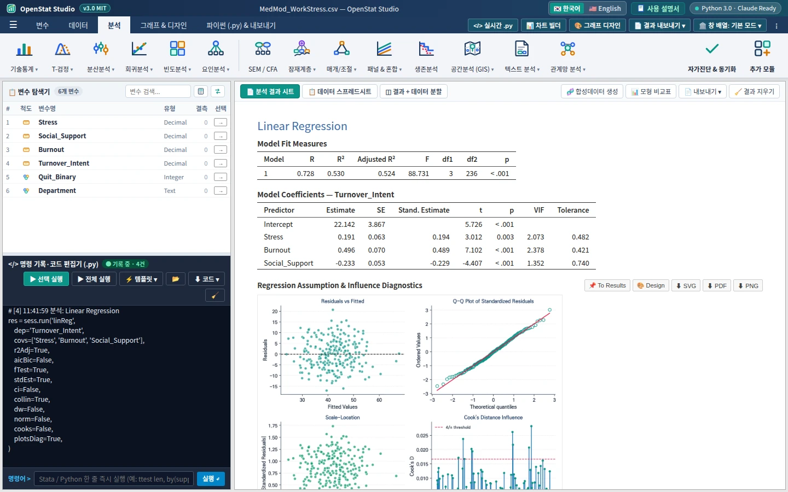</a></p>
<p align="center"><sub><b>기본 화면</b> — 왼쪽 위 변수 탐색기, 왼쪽 아래 명령어·신택스 편집기(실행한 분석의 코드 자동 기록), 오른쪽 분석 결과 시트</sub></p>

---

## 🖼️ 화면으로 보는 주요 기능

화면 사진은 `sample_data/`의 예제 자료로 실행한 결과임(화면 폭 1440px). 사진을 누르면 원래 크기로 열림.

<table>
<tr>
<td width="50%" valign="top"><a href="docs/images/02_layout_jamovi.webp">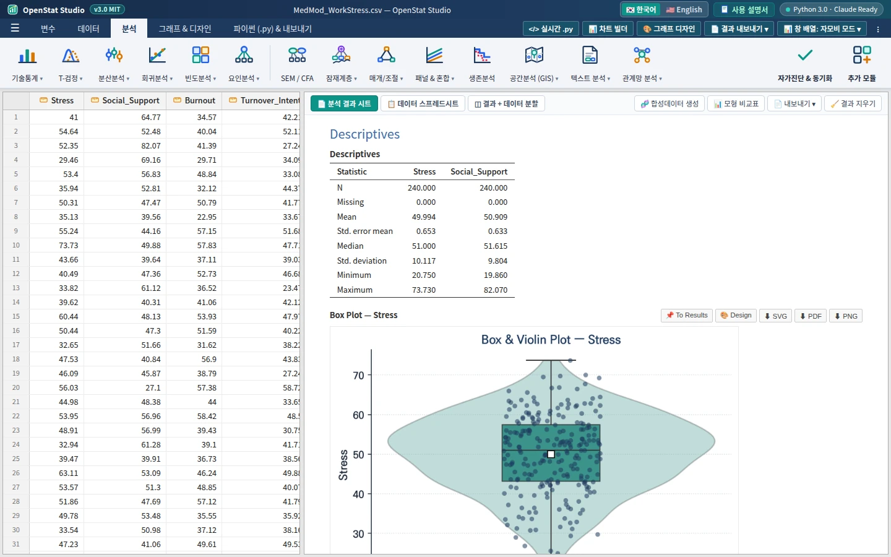</a><br><sub><b>창 배열</b> — 「창 배열」 메뉴의 6가지 배열 중 자모비 배열(왼쪽 데이터표, 오른쪽 결과)</sub></td>
<td width="50%" valign="top"><a href="docs/images/03_options_anova.webp">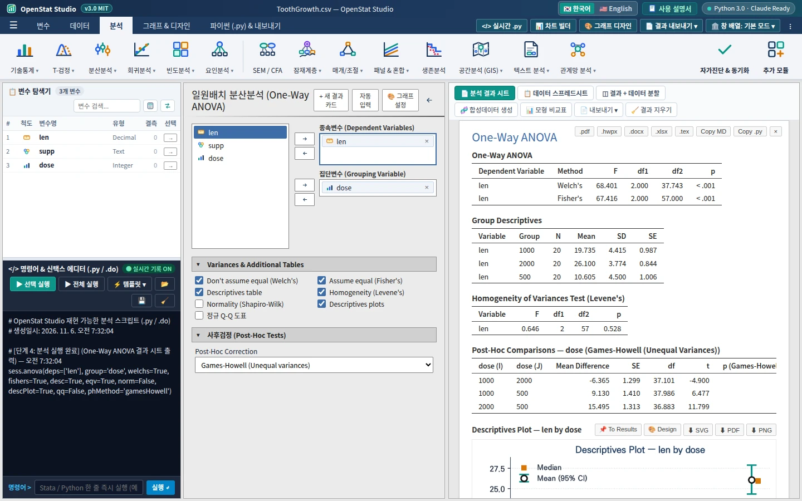</a><br><sub><b>분석 옵션 창</b> — 변수 지정·옵션 선택 즉시 결과 갱신(일원배치 분산분석, Levene 검정, Games-Howell 사후검정)</sub></td>
</tr>
<tr>
<td width="50%" valign="top"><a href="docs/images/04_chart_builder.webp">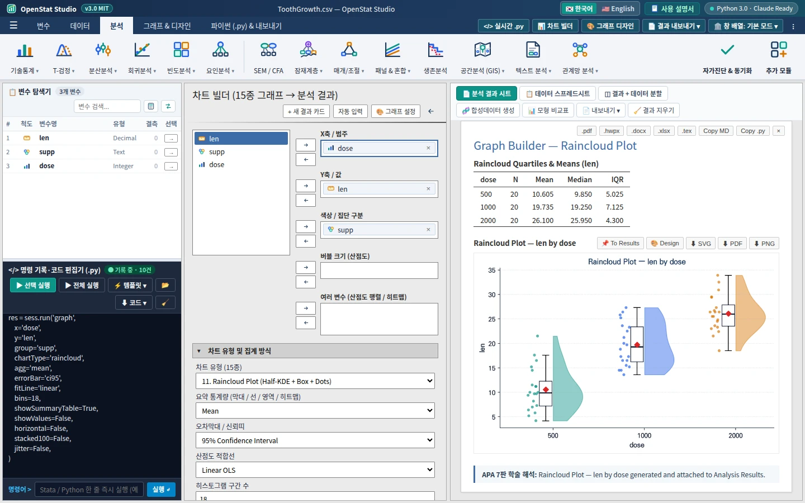</a><br><sub><b>차트 빌더</b> — 통계 검정과 별도로 15종 학술 그래프 작성(레인클라우드 그림)</sub></td>
<td width="50%" valign="top"><a href="docs/images/05_plot_design.webp">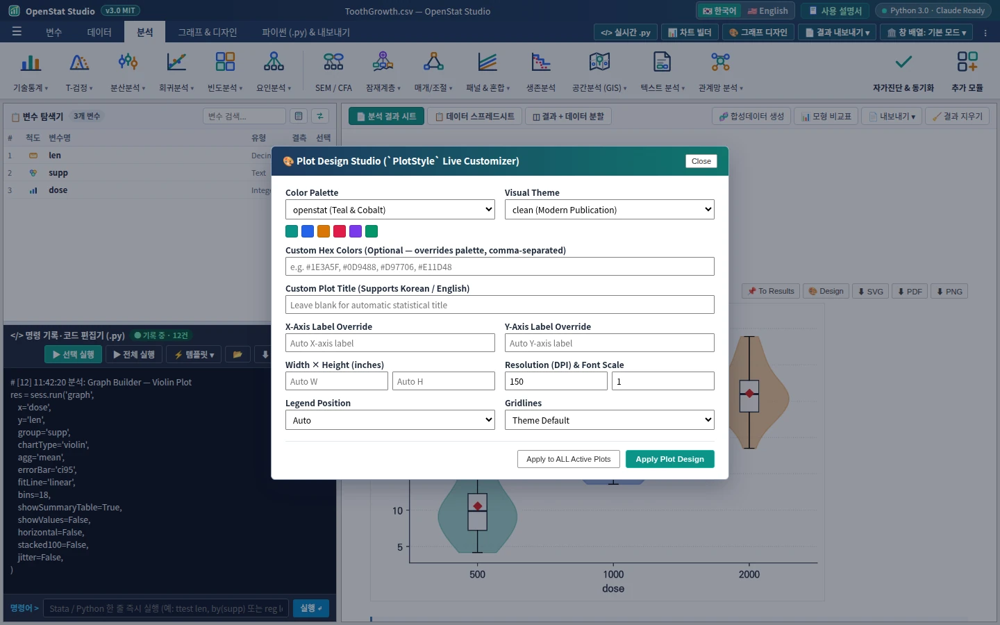</a><br><sub><b>그래프 디자인</b> — 색상 팔레트·테마·제목·축 이름·크기·해상도 지정</sub></td>
</tr>
<tr>
<td width="50%" valign="top"><a href="docs/images/06_ai_live_sync.webp">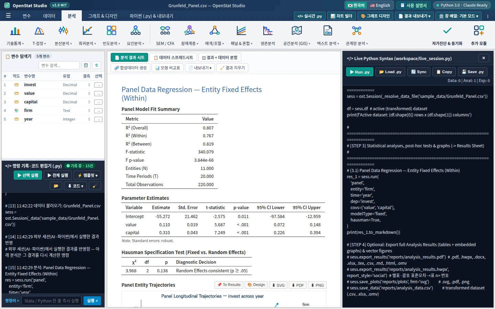</a><br><sub><b>AI·파이썬 연동</b> — 외부 파이썬 세션(Claude Code·SDK)에서 실행한 패널 고정효과 분석의 결과창 자동 반영, 오른쪽 실시간 코드 창의 재현 코드</sub></td>
<td width="50%" valign="top"><a href="docs/images/07_stata_syntax.webp">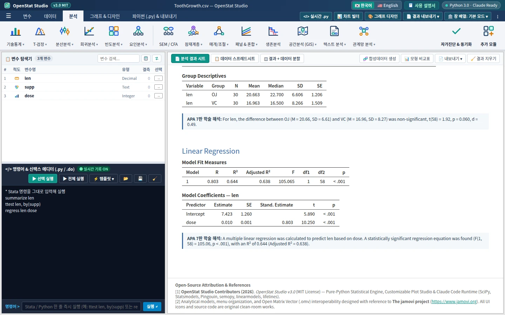</a><br><sub><b>Stata 명령 실행</b> — summarize·ttest·regress 등 Stata 명령을 신택스 편집기에 그대로 입력해 실행</sub></td>
</tr>
<tr>
<td width="50%" valign="top"><a href="docs/images/08_compare_modal.webp">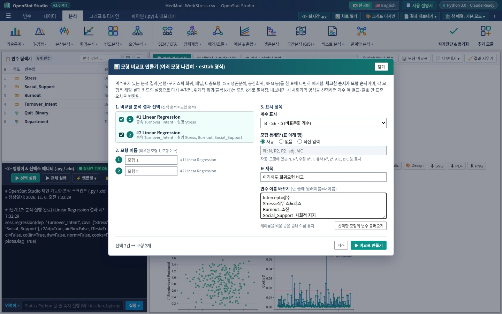</a><br><sub><b>모형 비교표 설정</b> — 비교할 회귀모형 선택, 모형 이름·변수 이름·표시 통계량 지정</sub></td>
<td width="50%" valign="top"><a href="docs/images/09_compare_table.webp">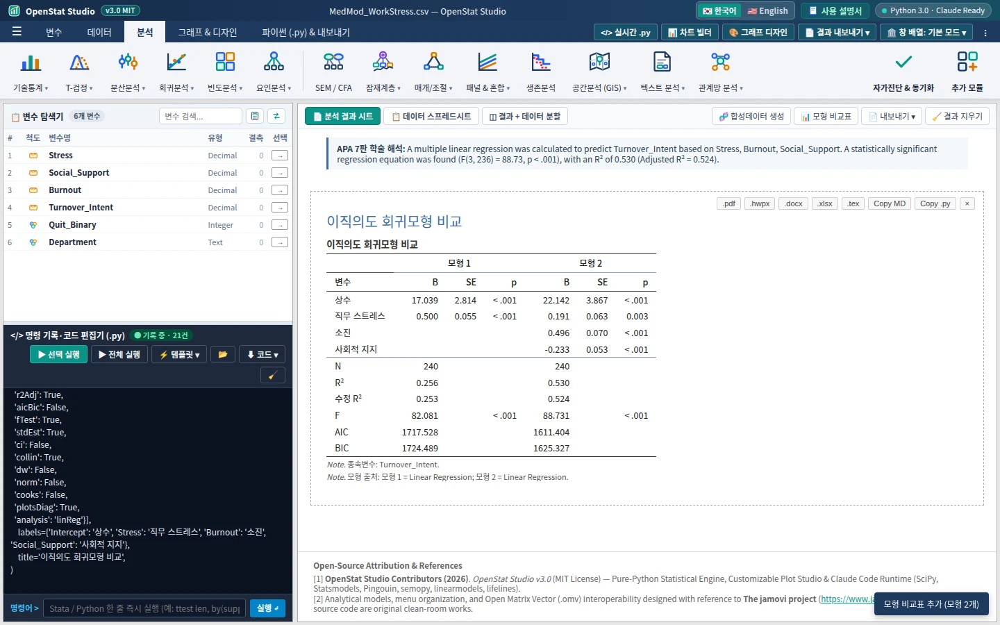</a><br><sub><b>모형 비교표 결과</b> — Stata esttab 형식의 모형 비교표(아래쪽 N·R²·수정 R²·F·AIC·BIC)</sub></td>
</tr>
<tr>
<td width="50%" valign="top"><a href="docs/images/10_report_style.webp">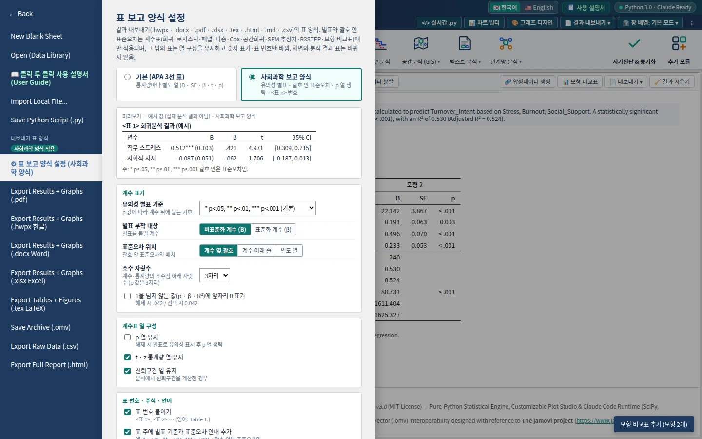</a><br><sub><b>표 보고 양식</b> — APA 기본 양식과 사회과학 보고 양식(유의수준 별표·괄호 표준오차·「<표 n>」 번호) 선택, 미리보기</sub></td>
<td width="50%" valign="top"><a href="docs/images/11_sem_builder.webp">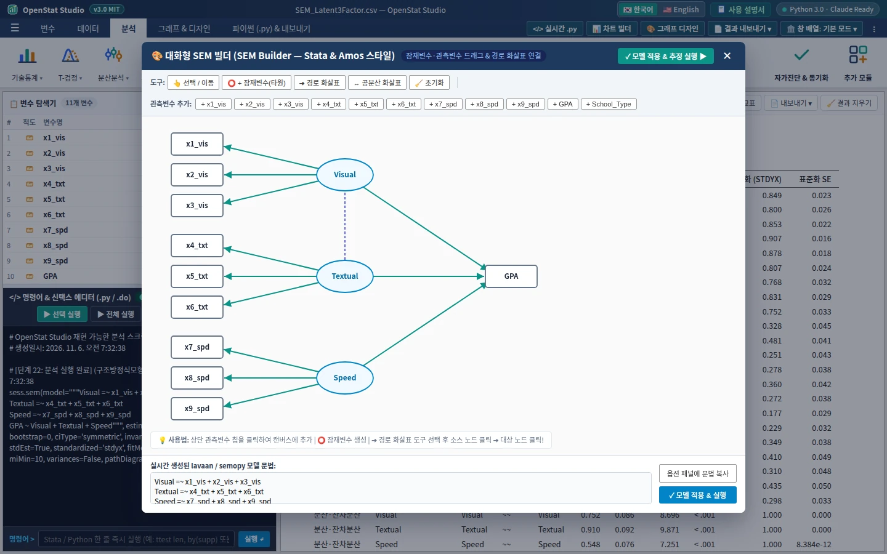</a><br><sub><b>SEM 빌더</b> — 잠재변수·관측변수·경로를 그려 구조방정식 모형 문법 생성</sub></td>
</tr>
<tr>
<td width="50%" valign="top"><a href="docs/images/12_sem_results.webp">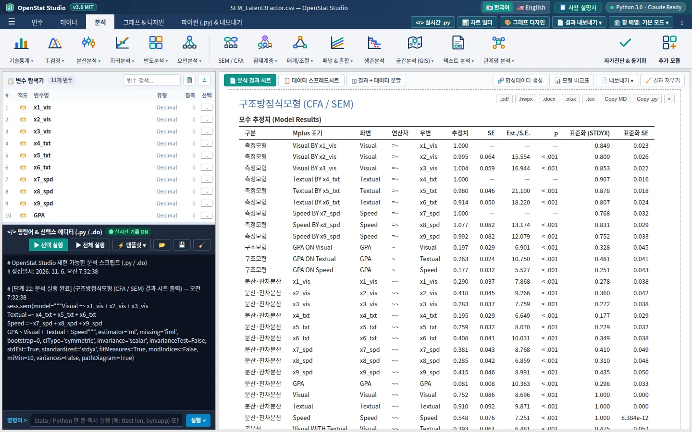</a><br><sub><b>구조방정식 결과</b> — Mplus 표기(BY·ON) 병기 모수 추정치와 표준화 추정치(STDYX)</sub></td>
<td width="50%" valign="top"><a href="docs/images/13_lca_profile.webp">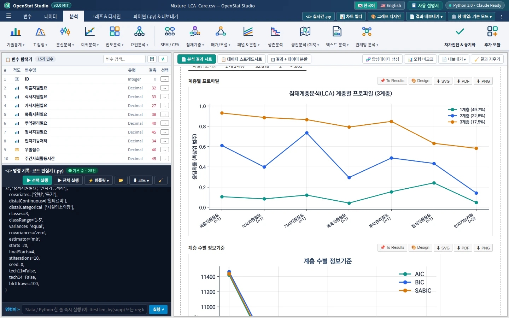</a><br><sub><b>잠재계층분석</b> — 계층별 응답확률 프로파일과 계층 수별 정보기준(AIC·BIC·SABIC)</sub></td>
</tr>
<tr>
<td width="50%" valign="top"><a href="docs/images/14_gis_lisa.webp">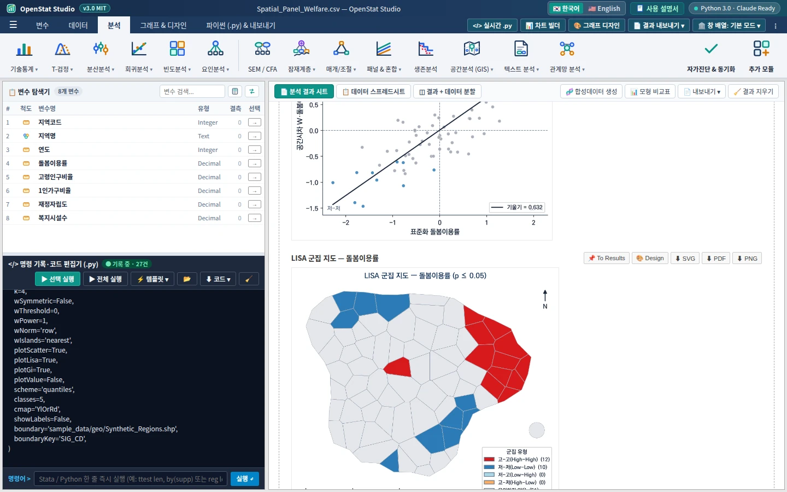</a><br><sub><b>GIS 공간분석</b> — Moran 산점도와 LISA 군집 지도(지도 경계 파일 자동 연결)</sub></td>
<td width="50%" valign="top"><a href="docs/images/15_text_network.webp">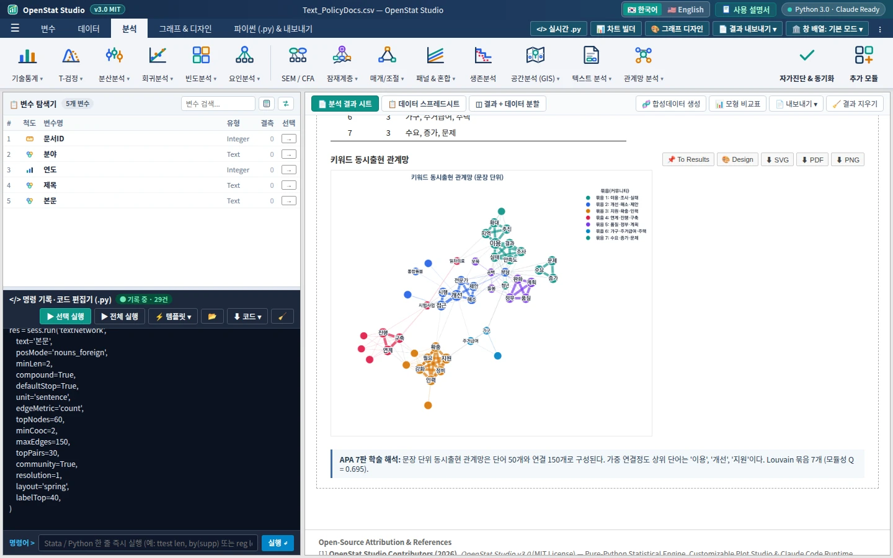</a><br><sub><b>텍스트 분석</b> — 정책문서 키워드 동시출현 관계망과 Louvain 묶음</sub></td>
</tr>
<tr>
<td width="50%" valign="top"><a href="docs/images/16_synthetic_data.webp">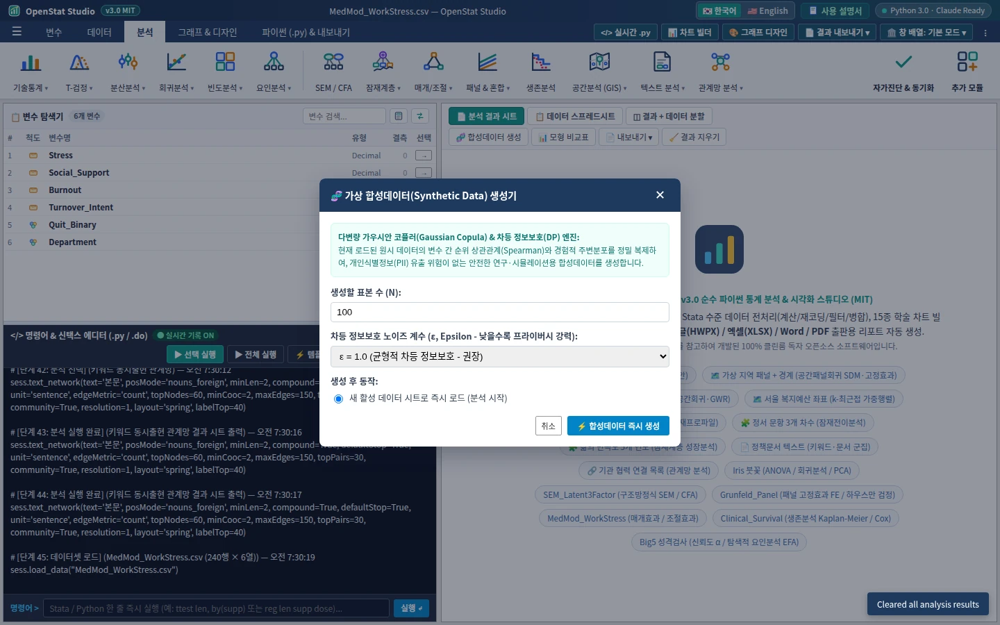</a><br><sub><b>합성데이터 생성기</b> — 현재 자료의 변수 간 순위상관·주변분포를 따르는 가상 자료 생성, 노이즈 수준(ε) 선택</sub></td>
<td width="50%" valign="top"><a href="docs/images/17_data_merge.webp">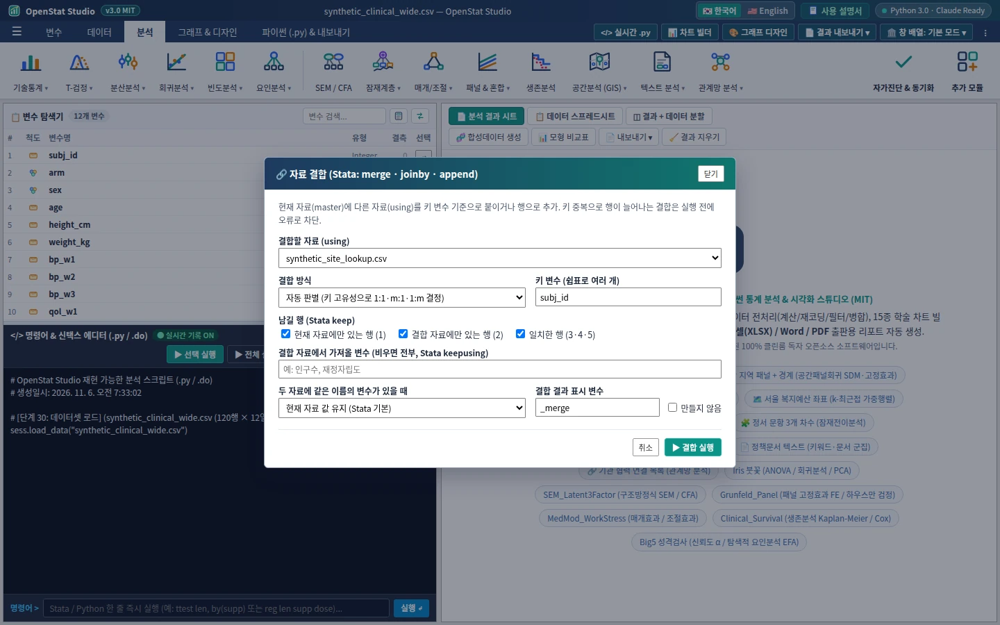</a><br><sub><b>자료 결합</b> — Stata merge 방식의 자료 결합(1:1·m:1·1:m 자동 판별, _merge 표시 변수)</sub></td>
</tr>
<tr>
<td width="50%" valign="top"><a href="docs/images/18_doctor.webp">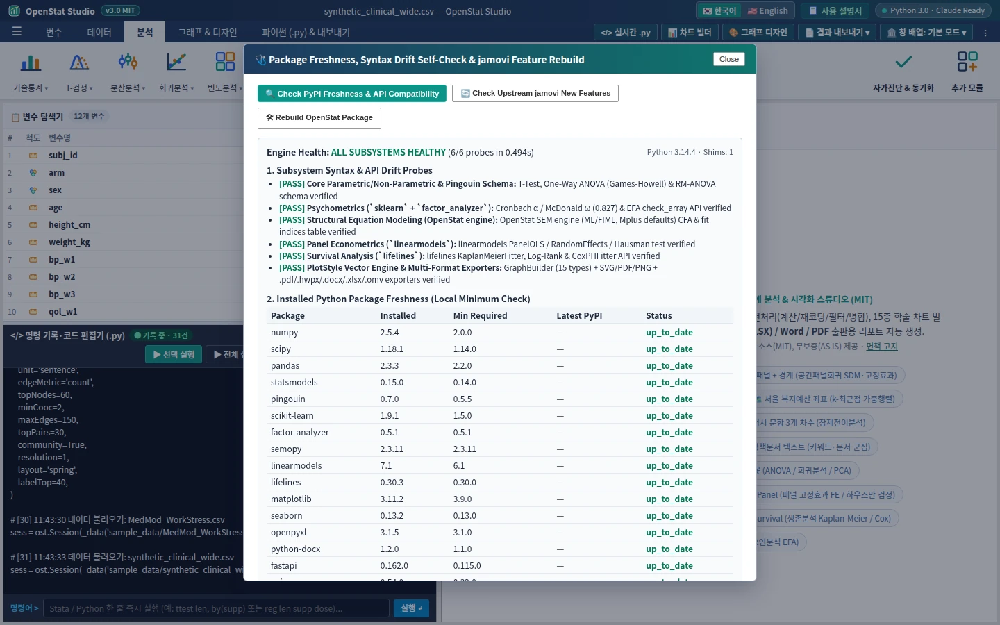</a><br><sub><b>자가진단</b> — 통계 엔진 하위 기능·API 호환성 점검과 설치 패키지 최신성 확인</sub></td>
<td width="50%" valign="top"><a href="docs/images/19_hwpx_output.webp">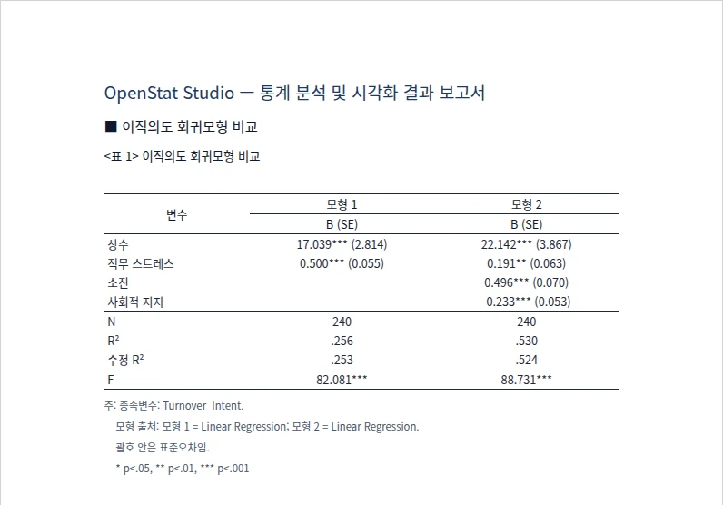</a><br><sub><b>한글(.hwpx) 출력</b> — 사회과학 보고 양식으로 저장한 모형 비교표(python-hwpx 미리보기로 렌더링, 한컴오피스 화면과 서체·간격 차이 가능)</sub></td>
</tr>
</table>


---

## ⚡ 빠른 시작 (3가지 사용 방식)

OpenStat Studio는 일반 사용자, AI 에이전트 사용자, 파이썬 연구자 모두를 위해 완벽하게 최적화된 3가지 실행 방식을 제공합니다.

### 🌟 방식 1. 일반 사용자 (마우스 1클릭 무설치형 실행)
복잡한 터미널 명령어 입력 없이, 마우스 클릭만으로 그래픽 화면(GUI) 프로그램을 엽니다.

1. GitHub 저장소 우측 상단의 **[Code] → [Download ZIP]** 을 클릭하여 다운로드한 뒤 원하는 폴더에 압축을 풉니다.
2. **실행 파일 더블클릭**:
   - **Windows**: `OPENSTAT_실행.bat` (또는 `START_OPENSTAT.bat`) 더블클릭!
   - **macOS / Linux**: 터미널에서 `./START_OPENSTAT.sh` 실행
3. **자동 환경 구성 및 앱 실행**:
   - 시스템에 Python이 설치되어 있으면, 최초 1회 필요한 가상환경(`.venv`)과 패키지를 자동으로 설치한 뒤 브라우저 독립 앱 창(`http://localhost:8500`)을 자동으로 띄웁니다.
   - 2회차 실행부터는 1초 만에 즉시 실행됩니다.
   - *종료 방법*: 검은색 콘솔 창을 닫거나 콘솔에서 아무 키나 누르면 서버 종료.
   - *공유 폴더 실행*: 네트워크 공유 폴더에서 실행하면 이 PC의 `%USERPROFILE%\OpenStatStudio`로 복사한 뒤 실행.

---

### 🤖 방식 2. AI 에이전트 사용자 (Claude Code로 말하듯이 분석하기)
터미널에서 **Claude Code**, Antigravity, Cursor 등 AI 에이전트를 열어 대화하듯 데이터를 분석하고 보고서를 생성합니다.

1. **원클릭 연동 등록**:
   - **Windows**: `SETUP_CLAUDE_CODE.bat` 더블클릭!
   - **macOS / Linux**: `./SETUP_CLAUDE_CODE.sh` 실행
   - *(또는 파이썬: `python scripts/setup_claude_code.py`)*
2. **Claude Code 실행 및 자연어 지시**:
   터미널에서 `claude`를 실행한 후 자연어로 입력하세요:
   > *"sample_data/ToothGrowth.csv 데이터 불러와서 dose별 t-검정하고 APA 표랑 박스플롯 그려줘"*  
   > *"패널 데이터 Grunfeld_Panel.csv로 고정효과 분석하고 결과 표를 HWPX, Excel로 만들어줘"*  
   > *"age가 65세 이상인 사람만 필터링해서 고혈압 유병률 교차분석해줘"*  
3. Claude Code가 OpenStat의 28종 통계 분석, 15종 그래프 빌더, 데이터 변환(Recode/Filter/Reshape/Compute), 한글(HWPX)/엑셀(XLSX)/워드(DOCX)/PDF 내보내기를 직접 실시간 실행합니다.

---

### 💻 방식 3. 파이썬 연구자 & 데이터 과학자 (`import openstat as ost`)
Jupyter Notebook, Google Colab 또는 파이썬 스크립트에서 Stata/R보다 직관적인 분석 코드를 작성합니다.

```python
import openstat as ost

# 1. 데이터 불러오기 (CSV, Excel, OMV, Parquet)
sess = ost.Session("sample_data/Grunfeld_Panel.csv")

# 2. 데이터 가공 (Stata do-file 동등 기능)
sess.compute("inv_cap_ratio", "invest / capital")
sess.filter("year >= 1940")

# 3. 고급 계량경제 패널 분석 (Entity Fixed Effects + Hausman Test)
res = sess.panel(
    entity="firm", time="year", dep="invest", covs=["value", "capital"],
    model_type="fixed", hausman=True,
    plotStyle={"palette": "kihasa", "theme": "apa_classic", "title": "패널 고정효과 모형 추세선"}
)

# 4. 11개 포맷 결과 표 및 고해상도 벡터 그래프 내보내기
res.export_results("reports/panel_report.hwpx")  # 한글 OWPML 네이티브 표 + 그림 삽입
res.export_results("reports/panel_report.xlsx")  # 엑셀 APA 3선 서식 표
res.export_results("reports/panel_social.hwpx", report_style="social")  # 사회과학 보고 양식: 0.512*** (0.103), <표 n>
res.save_plot("reports/panel_plot.svg")          # 출판용 벡터 SVG
sess.save_py("reports/analysis_script.py")       # 100% 재현 가능한 파이썬 스크립트
```

---

## 📋 사전 필수 요구사항 (Prerequisites)

- **Python 3.10 이상** (권장: Python 3.11, 3.12, 3.13, 3.14)
- **Windows 사용자 주의사항**:
  - Python이 설치되어 있지 않다면 [python.org/downloads](https://www.python.org/downloads/) 에서 다운로드하여 설치하세요.
  - **★ 설치 창 맨 아래의 `[Add python.exe to PATH]` 체크박스를 반드시 체크해야 합니다.**
  - `OPENSTAT_실행.bat` 실행 시 Python이 없으면 자동으로 다운로드 링크를 열어 안내합니다.
  - 공유 폴더(네트워크 드라이브)에서 실행 시 `%USERPROFILE%\OpenStatStudio`로 자동 복사·갱신 후 로컬 사본 실행 (위치 변경: 환경변수 `OPENSTAT_LOCAL_DIR`). PC2 등 원본 PC에서 바뀐 파일은 다음 실행 때 자동 반영.
  - 서버는 `127.0.0.1:8500`에만 연결되며, 서버 기록은 `workspace\server.log`에 저장.

---

## 🏛️ 라이선스 및 출처 고지

**OpenStat Studio**는 [MIT License](LICENSE)로 배포되는 오픈소스 프로젝트임.

- **참고 프로그램**: 분석 메뉴 구성, 결과표 양식, `.omv` 파일 호환 구조는 [jamovi](https://www.jamovi.org)를 참고하여 설계함. 상세 내용은 [`NOTICE.md`](NOTICE.md) 참조
- **GPL 의존 패키지 고지**: 일부 분석 모듈은 실행 시 GPL 라이선스 패키지(`pingouin` GPL-3.0, `factor_analyzer` GPL-2.0)를 불러옴. 저장소 소스코드에는 이들 패키지가 포함되지 않으며, 이들 패키지를 함께 묶어 재배포하는 경우 해당 GPL 조건을 따라야 함. 상세 내용은 [`NOTICE.md`](NOTICE.md) 3.2절 참조.
- **면책 고지**: [면책 고지 및 이용 조건](#disclaimer) 참조

---

## 🔬 주요 기능 상세 (v3.0)

### 1. 순수 파이썬 통계 분석 엔진 (45종)
- **기술통계 및 탐색**: 요약통계, Violin/Raincloud 플롯, 산점도(LOESS 추세선 + 주변 밀도도/박스플롯), Pareto 차트, Q-Q 플롯.
- **T-검정 & 분산분석(ANOVA)**: 독립표본 / 대응표본 / 일표본 T-검정, Welch & Fisher 일원배치 분산분석, 요인분산분석(Type I/II/III SS, $\eta^2$, $\eta^2_p$, $\omega^2$), 공분산분석(ANCOVA), 반복측정 분산분석(Mauchly 구형성 검정 + Greenhouse-Geisser/Huynh-Feldt), Kruskal-Wallis, **5종 사후검정**(Tukey HSD, Games-Howell, Scheffé, Bonferroni, Holm).
- **회귀분석 & 범주형 데이터**: 상관행렬, 편상관, OLS 다중선형회귀(VIF 다중공선성, Durbin-Watson 잔차독립성, Cook's Distance, 2×2 진단도), 이항 로지스틱 회귀(Odds Ratio, ROC/AUC 곡선), 교차분할표($\chi^2$, Fisher 직접확률, Cramér's $V$).
- **심리측정 & 요인분석**: 신뢰도 분석(Cronbach's $\alpha$, McDonald's $\omega$), 주성분분석(PCA), 탐색적 요인분석(EFA - MinRes / ML / Principal Axis + Varimax / Promax / Oblimin 회전 + 평행분석 스크리 도표).
- **구조방정식 모형 (SEM / CFA, Mplus 기본 설정)**: 자체 추정 엔진. 모형 문자열(`=~`, `~`, `~~`, `~ 1`, `a*x` 라벨, `1*x` 고정, `:=` 정의 모수, `==` 제약)과 Python 옵션으로 지정. ML(기본)·MLR(샌드위치 SE, Yuan–Bentler 척도 χ²), 결측 FIML(기본), 평균구조, 외생 관측변수 조건부 처리, 다집단(기본: 적재량·절편 동일)과 측정동일성 단계 비교, 간접효과(MODEL INDIRECT, 델타법·붓스트랩 신뢰구간), 수정지수(MODINDICES), STDYX·STDY·STD 표준화, R², 적합도(χ², RMSEA 90% CI, CFI, TLI, SRMR, AIC, BIC, SABIC), 경로도.
- **잠재계층·혼합모형 (Mplus 기본 설정)**: 잠재계층분석(LCA)·잠재프로파일분석(LPA)·잠재전이분석(LTA)·잠재계층 성장분석(LCGA). MLR, STARTS 20 4, FIML, 계층 수 비교(AIC·BIC·SABIC·엔트로피), VLMR·조정 LMR(TECH11)·부트스트랩 LRT(TECH14), 분류 정확도, 3단계 보조분석(R3STEP·BCH·DCAT), 사례별 사후확률.
- **계량경제 패널 분석 & 다층모형**: 개체 고정효과(Fixed Effects Within), 이원 고정효과(Two-Way FE), 확률효과(Random Effects GLS), 통합 OLS(Pooled OLS), 클러스터 로버스트 표준오차, **하우스만 사양검정(Hausman Test, $\chi^2$)**, 선형 혼합모형(Multilevel Linear Mixed Models - REML, ICC).
- **베이지안 통계 & 생존분석**: JZS 코시 베이지안 T-검정/ANOVA/상관분석 ($BF_{10}$), 부트스트랩 매개효과(직접/간접/총효과 95% 신뢰구간), 조절효과(Simple Slopes), Kaplan-Meier 생존곡선 및 Cox 비례위험 모형.

### 2. Stata `.do` 파일 수준의 데이터 전처리 GUI 리본 & 모달
- **변수 보기 (Variables View)**: 변수 척도(명목/서열/연속), 데이터 유형, 결측치 수치, 요약 통계(평균±표준편차, 범주 목록) 및 변수별 즉시 삭제/리코드 버튼.
- **데이터 처리 버튼**:
  - `[Compute]`: 파이썬 수식 기반 새 변수 생성 (`weight / (height/100)**2`)
  - `[Recode]`: 구간별 / 개별값 리코드 및 레이블 지정 (모달 대화상자)
  - `[Filter]`: 조건식 기반 행 필터링 (`age >= 20 and gender == 1`)
  - `[Merge Data]`: 두 데이터셋 간 Key 변수 기준 결합 (Inner, Left, Right, Outer)
  - `[Reshape]`: Wide 형 $\leftrightarrow$ Long 형 변환
  - `[Transform (Z)]`: 표준화 (Z-score, Min-Max, Robust)
  - `[Undo]`: 1단계 작업 취소 및 이전 상태 복원

### 3. 독립형 15종 학술 그래프 빌더 (`GraphBuilder`)
통계 검정과 완전히 독립적으로 논문용 차트를 그리고 결과 시트에 추가할 수 있습니다:
- `bar`, `stacked_bar`, `line`, `area`, `pie`, `donut`, `histogram`, `density`, `box`, `violin`, `raincloud`, `scatter` (버블 + OLS/LOESS 회귀선), `pairplot`, `heatmap`, `errorbar` (Forest CI 플롯).

### 3-1. 텍스트 분석 & 관계망 분석 (리본 [텍스트 분석]·[관계망 분석])
- **텍스트 파일 불러오기**: `.txt` `.md` `.docx` `.pdf` `.hwpx` 파일·폴더 → 문서 1건 = 1행 데이터 (문서ID·파일명·폴더·형식·글자수·본문). SDK: `ost.load_texts("폴더")`
- **키워드 분석** (`textKeywords`): kiwipiepy 형태소 분석, 사용자 사전·불용어·유의어 통합, 빈도·문서 빈도·TF-IDF 표, 집단별 특징 키워드(c-TF-IDF), 워드클라우드
- **키워드 동시출현 관계망** (`textNetwork`): 문장·문서 단위 동시출현, 빈도·Jaccard·NPMI 연결 강도, 중심성, Louvain 묶음, 관계망 그림
- **문서 군집 분석** (`textCluster`): TF-IDF+LSA(기본) 또는 문장 임베딩(`BAAI/bge-m3` 등, `requirements-embedding.txt` 선택 설치) → UMAP → HDBSCAN·k-평균·Ward, 군집별 대표 키워드(c-TF-IDF), 미분류 재배정, 상위 주제 묶음, 시드 3개 안정성(ARI), 군집 분포도·군집 관계망·문서 유사도 관계망
- **관계망 분석** (`graphNetwork`): 연결 목록(출발·도착·가중치) → 밀도·경로 길이·군집계수, 중심성 6종(연결·가중 연결정도·매개·근접·고유벡터·PageRank), Louvain 묶음, 관계망 그림
- 예제 데이터: `sample_data/Text_PolicyDocs.csv` (합성 정책문서 150건), `sample_data/Network_Collaboration.csv` (합성 기관 협력 86건)

### 3-2. GIS 공간분석 (리본 [공간분석 (GIS)]·데이터 탭 [지도 경계 연결])
- **지도 경계 연결**: `.shp`(+`.shx` `.dbf`, 선택 `.prj` `.cpg`)·`.zip`·`.geojson`·`.gpkg`를 데이터의 지역 코드와 연결(연결 변수 자동 추천·일치율 확인), 또는 경계 속성표를 데이터로 열기. `.cpg`가 없는 한글 속성표는 CP949로 읽음. 좌표 변수(경도·위도)만으로도 분석 가능
- **공간가중행렬** (`spatialWeights`): 퀸·룩 인접(1~3차), k-최근접, 거리 임계값, 역거리, 외부 파일(.gal·.gwt·.csv) / 행 표준화·스펙트럼(Stata 기본)·최소-최대 정규화 / 이웃 없는 지역 처리(최근접 연결·제외·유지) / 연결 지도, `.gal`·`.gwt`·Stata `spmatrix fromdata`용 `.csv` 저장
- **공간자기상관** (`spatial_moran`): 전역 Moran's I(정규 근사·순열), LISA 군집(조건부 순열, FDR·Bonferroni 보정), Getis–Ord Gi* 열점·냉점, 주제도(분위수·자연 구분·등간격)
- **횡단면 공간회귀** (`spatial`, Stata `spregress`): OLS·SLX·SAR·SEM·SDM·SDEM·SAC 최우추정, OLS 진단(잔차 Moran's I, LM·강건 LM, Jarque–Bera, Koenker–Bassett, 조건수), 7개 모형 비교·LR 검정, 직접·간접·총효과(델타 방법·모의추출), OIM·EIM 표준오차
- **공간패널회귀** (`spatialPanel`, Stata `xsmle`·`spxtregress`): 지역·시점·양방향 고정효과(Lee–Yu 보정), 확률효과(SAR·SDM), Hausman 검정, 패널 LM 검정, 효과 분해, 균형패널 자동 구성
- **지리가중회귀** (`gwr`, mgwr): 이중제곱·가우시안·지수 커널, 적응형·고정 대역폭, AICc 선택, 유효 모수 보정 유의성, 국지 계수 지도, 몬테카를로 공간 변이 검정
- 모든 분석 결과 첫 표에 **분석 가정·설정**(가중행렬 기준·정규화·고립 지역 처리·모형·패널 효과·편의보정·표준오차 기준) 기록
- 검증: 횡단면 SAR·SEM·SDM·SDEM 계수·로그우도와 EIM 표준오차, LM 검정, 패널 고정효과·확률효과 SAR 추정값이 PySAL `spreg`와 일치(`tests/test_spatial.py`)
- 예제 데이터(합성): `sample_data/geo/Synthetic_Regions.shp`(가상 73개 지역), `Spatial_Panel_Welfare.csv`(73개 지역 × 8년), `Spatial_CrossSection_Welfare.csv` — 예제 자료를 열면 경계가 자동 연결됨
- SDK: `sess.attach_boundary("경계.shp", key="SIG_CD", data_key="지역코드")` → `sess.spatial_panel(dep=..., covs=[...], timeVar="연도", model="sdm", effectsType="fe", feType="both")`

### 4. 11개 포맷 결과 보고서 내보내기 (통계 표 + 고해상도 그림)
- **`.hwpx`**: 한글 OWPML 네이티브 편집 가능 표(`<hp:tbl>`) **+ 삽입된 PNG 그림(`<hp:pic>`)**
- **`.pdf`**: 다면 출판 품질의 APA 3선 표 및 고해상도 그래프 리포트
- **`.docx`**: 마이크로소프트 워드 네이티브 APA 표 + 차트
- **`.xlsx`**: 엑셀 전용 APA 테두리 서식 시트 + 차트 이미지 시트
- **`.tex`**: LaTeX `booktabs` 표 + `\includegraphics` 벡터 PDF 그림 세트
- **`.html`**, **`.md`**, **`.csv`**, **`.tsv`**, **`.json`**, **`.omv`**
- **사회과학 보고 양식 (`report_style="social"`)**: 회귀 계열 계수표에만 유의수준 별표(`* p<.05, ** p<.01, *** p<.001`, 선택 시 `†`), 계수 옆·아래 괄호 표준오차, p 열 생략, 1을 넘지 않는 값의 앞자리 0 생략을 적용하고, 모든 표에 「<표 n>」 번호와 묶음 머리글 셀 병합을 붙임. 엑셀은 계산용 원자료 시트를 함께 저장
- **모형 비교표 (`sess.compare_models`)**: 여러 모형(또는 위계적 회귀의 블록)을 열로 나란히 놓고 아래에 N·R²·AIC 등을 두는 Stata `esttab` 형식 표

---

## 🛠️ 자체 점검 및 유지보수 CLI (`openstat`)

```bash
# 1. 패키지 최신성 점검 및 upstream 문법 변화 자가 진단 (Doctor)
.venv/bin/openstat doctor        # Linux / macOS
.venv\Scripts\openstat doctor    # Windows

# 2. 참고 프로그램(jamovi) 신규 분석 목록 점검 및 재빌드
.venv/bin/openstat sync-jamovi
.venv/bin/openstat rebuild

# 3. 전체 분석 모듈 및 색상 팔레트 목록
.venv/bin/openstat catalog
.venv/bin/openstat palettes
```

---

## 📁 프로젝트 폴더 구조

```
OpenStat-Studio/
├── OPENSTAT_실행.bat        # [Windows] 마우스 1클릭 자동 부트스트랩 실행기
├── START_OPENSTAT.bat       # [Windows] 로컬 서버 구동 및 앱 화면 런처
├── STOP_OPENSTAT.bat        # [Windows] 백그라운드 서버 안전 종료 스크립트
├── START_OPENSTAT.sh        # [macOS/Linux] 자동 부트스트랩 실행기
├── STOP_OPENSTAT.sh         # [macOS/Linux] 서버 종료 스크립트
├── SETUP_CLAUDE_CODE.bat    # [Windows] Claude Code AI 연동 원클릭 스크립트
├── SETUP_CLAUDE_CODE.sh     # [macOS/Linux] Claude Code AI 연동 스크립트
├── .mcp.json                # Claude Code MCP 설정 (SETUP_CLAUDE_CODE 실행 시 PC별 생성, Git 추적 제외)
├── CLAUDE.md                # Claude Code 에이전트 지침서
├── README.md                # 영문 & 국문 통합 안내서
├── README_KR.md             # 한국어 상세 매뉴얼
├── NOTICE.md                # 오픈소스 출처 및 라이선스 고지
├── LICENSE                  # MIT 라이선스 전문
├── requirements.txt         # 패키지 의존성 목록
├── setup.py                 # pip 설치 및 CLI 등록 스크립트
├── docs/                    # 사용 설명서(user_guide.html)·화면 사진(images/)
├── reconstructed/           # 파이썬 소스 코드
│   ├── pyjamovi/            # 통계 엔진, 데이터 전처리, 시각화, 웹 UI
│   │   ├── analyses/        # 28종 통계 분석 모듈
│   │   ├── data_ops.py      # Stata 수준 데이터 변환 엔진
│   │   ├── exporters/       # 11개 포맷 내보내기 엔진
│   │   └── web/             # 웹 화면(UI)과 SVG 아이콘
│   └── openstat/            # openstat 네임스페이스 및 CLI/MCP 엔트리포인트
├── sample_data/             # 패널, SEM, 분산분석 등 실습용 데이터셋
└── workspace/               # 실시간 파이썬 스크립트(live_session.py) 동기화 공간
```

---

<a id="disclaimer"></a>

## ⚠️ 면책 고지 및 이용 조건

본 고지는 [MIT License](LICENSE)의 보증 부인·책임 제한 조항에 더하여 적용됨. 본 프로그램을 내려받거나 사용하는 경우 이 고지에 동의한 것으로 봄.

1. **개발 주체**: 본 프로그램은 개인 개발자가 개인 자격으로 개발·공개한 오픈소스 소프트웨어임. 개발자가 소속된 기관이나 제3자의 공식 제품·서비스·견해와 무관함
2. **무보증**: 본 프로그램과 설명자료는 "있는 그대로(AS IS)" 제공됨. 정확성·완전성·상품성·특정 목적 적합성·오류 없는 작동·지속 제공에 대해 명시적·묵시적 보증을 하지 않음
3. **분석 결과의 확인 책임**: 분석 결과(추정값·검정 통계량·그림·내보낸 문서)의 해석과 사용 책임은 이용자에게 있음. 학술 발표, 정책 결정, 임상·법률·재무 판단 등 중요한 용도에 사용하기 전 검증된 다른 소프트웨어나 전문가 검토로 결과를 교차 확인해야 함. 다른 소프트웨어의 명칭이나 기본 설정을 표기한 기능(예: 「Mplus 기본 설정」, 「Stata merge 방식」)도 해당 소프트웨어와 같은 결과를 보증하지 않음
4. **책임 제한**: 관련 법령이 허용하는 최대 범위에서, 개발자와 기여자는 본 프로그램의 사용 또는 사용 불능, 프로그램 오류, 결과 차이, 자료 손실·파일 손상, 제3자 서비스 연동으로 발생한 직접·간접·부수·특별·결과적 손해에 대해 책임을 지지 않음
5. **자료와 개인정보**: 이용자가 불러오고 처리하는 자료의 적법한 수집·이용·보관·파기(「개인정보 보호법」, 「통계법」, 연구윤리·기관생명윤리위원회 규정 등 포함)는 이용자의 책임임. 분석은 이용자 PC에서 실행되나, 패키지 설치·최신성 점검(PyPI), 참고 프로그램 신규 기능 점검(GitHub), 문장 임베딩 모델 내려받기(Hugging Face) 기능은 외부 서버와 통신함. Claude Code 등 외부 AI 도구와 함께 사용하는 경우 자료와 결과가 해당 서비스 제공자에게 전송될 수 있으며, 그 처리는 해당 서비스의 약관을 따름. 민감 자료는 AI 연동 전 소속 기관의 규정을 확인해야 함
6. **합성데이터**: 합성데이터 생성 기능은 비식별 조치의 적정성이나 재식별 불가능성을 보증하지 않음. 합성데이터를 공개·반출하기 전 관련 기준에 따른 별도 평가가 필요함
7. **상표와 제3자 권리**: SPSS, Stata, SAS, Mplus, jamovi, JASP, 한글·한컴오피스, Microsoft Word·Excel, Claude 등 이 문서와 프로그램에 나오는 제품명·상표는 각 권리자의 소유임. 본 프로그램은 이들 권리자와 제휴·후원·보증 관계가 없으며, 제품명은 호환성과 기능 설명 목적으로만 사용함
8. **제3자 소프트웨어**: 본 프로그램이 설치·사용하는 제3자 패키지, 서체, 모델은 각자의 라이선스를 따름. 일부 GPL 패키지(`pingouin`, `factor_analyzer`)를 함께 묶어 재배포하는 경우 해당 라이선스 조건의 준수 책임은 재배포자에게 있음([NOTICE.md](NOTICE.md) 참조)
9. **게시 중단과 변경**: 저작권·상표권 등 권리 침해 우려가 제기되거나 개발자가 필요하다고 판단하는 경우, 사전 통지 없이 저장소와 배포물의 전부 또는 일부를 수정·비공개·삭제할 수 있음. 개발자는 기술 지원, 업데이트, 오류 수정을 제공할 의무가 없음
10. **권리 침해 신고**: 본 저장소의 내용이 권리를 침해한다고 판단되는 경우 [GitHub Issues](https://github.com/beaver21c/pyopenstat/issues)로 알려 주면 확인 후 조치함

**Disclaimer (English summary).** OpenStat Studio is open-source software developed and published by an individual in a personal capacity under the MIT License. It is not an official product or position of the developer's employer or of any third party. The software and its documentation are provided "AS IS", without warranty of any kind. Users are solely responsible for verifying results before relying on them (including academic publication, policy, clinical, legal or financial decisions) and for the lawful handling of their data, including data sent to third-party AI services used together with this software. To the maximum extent permitted by applicable law, the developer and contributors are not liable for any direct, indirect, incidental, special or consequential damages arising from the use of, or inability to use, the software. Product names and trademarks belong to their respective owners; no affiliation or endorsement is implied. The developer may modify, make private or remove this repository, in whole or in part, at any time without notice, including in response to rights concerns, and has no obligation to provide support or updates.
