# OpenStat Studio v3.0 (`pyopenstat`)

🌐 [한국어](README.md) · **English**

🔗 **Repository** <https://github.com/beaver21c/pyopenstat> · ⬇️ **[Download (ZIP)](https://github.com/beaver21c/pyopenstat/archive/refs/heads/main.zip)** · 📖 **User Guide** [View online](https://raw.githack.com/beaver21c/pyopenstat/main/docs/user_guide_en.html) / [File](docs/user_guide_en.html) · ⚠️ **[Disclaimer](#disclaimer)**

**A Python statistics program for the social sciences that works with AI · Statistical-package workspace · Hangul (.hwpx) output**

*Python-based statistical software for the social sciences · AI (Claude Code) integration · Statistical-package style workspace · Hangul (.hwpx) / Word / Excel / PDF report export*

[](LICENSE)
[](setup.py)
[](scripts/setup_claude_code.py)
[](START_OPENSTAT.bat)

[Korean guide (README_KR.md)](README_KR.md) | [Claude Code guide (CLAUDE.md)](CLAUDE.md) | [Attribution and license notice (NOTICE.md)](NOTICE.md)

---

## ✨ Main Strengths

- **Direct AI integration**: AI tools such as Claude Code run analyses themselves through the MCP tools, the command line (`openstat`) and the Python SDK, then read the code log and results log to revise and re-run them. Analyses run from an outside session also appear in the open program window
- **Statistical-package workspace**: Variable Explorer, data spreadsheet, analysis options panel, Results sheet and a command log / code editor that also runs Stata commands, all on one screen, with six window layouts to choose from
- **Coverage of social-science methods**: 66 analyses and 15 graph types: descriptive statistics, t-tests, ANOVA, regression, factor analysis and reliability; structural equation modeling (Mplus defaults, WLSMV for categorical variables, cross-lagged and latent growth model templates); latent class, latent transition and latent class growth analysis; panel models (fixed, random and correlated random effects; nonlinear panel logit, Poisson, negative binomial, tobit and ordered models; FGLS, PCSE and Hausman–Taylor; dynamic panel GMM; panel instrumental variables; difference in differences and event studies; panel unit-root and cointegration tests) and multilevel models (three or more levels); instrumental variables and time series (ARIMA); count models (Poisson, negative binomial, zero-inflated) and limited dependent variable models (probit, ordered, multinomial, tobit, Heckman); survival analysis, Bayesian tests, mediation and moderation; GIS spatial regression, spatial panels and geographically weighted regression; text and network analysis
- **Hangul (.hwpx) output and report style**: Result tables (as tables that can be edited in Hangul) and figures are saved to a Hangul word-processor document. A social-science report style adds significance stars, standard errors in parentheses and numbered captions (`<표 n>`, or `Table n.` with English notes), and a model comparison table follows the Stata `esttab` layout. Eleven formats are supported in all, including Word, Excel, PDF and LaTeX
- **Stata-style data management**: merge (1:1, m:1, 1:m, with the `_merge` indicator variable), reshape, recode, destring and encode; undo; reading and writing .dta, .sav and .omv files; importing text files and map boundary files; generating synthetic data
- **Reproducible record of the analysis**: Every command from loading the file onward (data management, analyses, typed commands, exports) is appended in order to one Python file, `workspace/command_log.py`, which runs again as it is. Stata (.do) and R (.R) versions are produced by conversion when you ask for them
- **Free and local**: Free to use under the MIT License. The program runs on your own PC, and its web interface listens only on 127.0.0.1. Launch files are provided for Windows, macOS and Linux

## 🧭 Background

**Where existing workflows fall short**

- The statistical packages common in the social sciences (SPSS, Stata, SAS and others) have little built-in connection to AI. The usual routine is to copy code and output from the package into an AI chat, paste the corrected code back into the package, run it, and repeat
- Each package has its own command language (SPSS Syntax, Stata do-files, SAS programs and so on). Where the AI does not handle that language well, errors follow, and the researcher is left to type, fix and re-run the code by hand

**Design principles**

1. **A statistical engine written in Python**: Estimation, data management and export are all implemented in Python, the language AI uses most for data analysis code. An AI tool (Claude Code and others) runs analyses through the command line, the MCP tools or the Python SDK, checks the results by reading the code log (`workspace/live_session.py`) and the results log (`workspace/live_session.json`), and then revises and re-runs. The same results show up live in the results and code panes of the open program window
2. **The look of a familiar statistics program**: An analysis done by AI alone is hard to keep track of: the steps and results are not easily recorded, managed or checked by eye. The program therefore takes the form of a statistics package, with a screen for creating and editing variables, a results pane and a code pane, so that researchers can follow, review and correct what the AI does
3. **jamovi as a reference, with more methods added**: The menu layout and result tables were designed with reference to jamovi. Further methods were added so that the analyses in common use in the social sciences are covered: panel and dynamic panel models, difference in differences, instrumental variables, time series, count and limited dependent variable models, multilevel models, structural equation modeling (Mplus defaults), latent class and mixture models, GIS spatial regression, text and network analysis and others. They are computed with Python libraries (statsmodels, linearmodels, arch and others); where no library provides a computation, it follows the formulas of the original papers and the Methods and formulas sections of the Stata and Mplus manuals, and the source is named in the table notes and in the "Implementation Basis" section of the user guide (Chapter 25-1). Options, defaults and reported statistics follow Stata conventions for the econometric, limited dependent variable and multilevel models, and lavaan and Mplus conventions for structural equation modeling
4. **Writing papers and reports (Hangul .hwpx output)**: Papers and reports in Korea are mostly written in the Hangul word processor, so result tables and figures are saved straight to Hangul (.hwpx) documents. Tables are created as Hangul tables that can be edited, and a social-science report style with significance stars, standard errors in parentheses and numbered captions (`<표 n>`) can be selected. SPSS, Stata, SAS, jamovi and JASP have no Hangul (.hwpx) export (checked November 2026); with these packages, output exported to Word, Excel or HTML has to be rearranged again in Hangul

## 🎯 Potential Uses

- **Theses and journal articles**: Result tables are saved to Hangul or Word documents and go straight into the manuscript. The social-science report style and the model comparison table reduce the work of putting tables into journal format
- **Policy and research reports**: Numbered captions (`<표 n>`) and Hangul tables match the format of Korean reports. Choropleth maps and spatial regression for regional data such as si/gun/gu (city, county, district) units; keyword and topic analysis of policy documents
- **Analysis together with AI**: The researcher sets the direction and the AI runs the analysis; the researcher reviews and corrects the Results sheet and the code log on screen. Because the history of the analysis is kept as code, it can be checked and shared with co-researchers
- **Teaching statistics and methods**: Each menu operation is recorded as Python code together with the matching Stata command, so learning the menus and learning to write code go hand in hand. Because the program is free, setting up a computer lab costs less effort
- **Moving from Stata or SPSS to Python**: Stata commands can be typed and run, Stata-style data management (merge, reshape and others) stays the same, and .dta and .sav files can be read and written
- **Sharing data and checking reproducibility**: Analysis scripts (.py) and work files (.omv) can be saved. Example datasets can be made from synthetic data (the re-identification risk must be assessed separately before release)

---

<p align="center"><a href="docs/images/01_main_default.webp">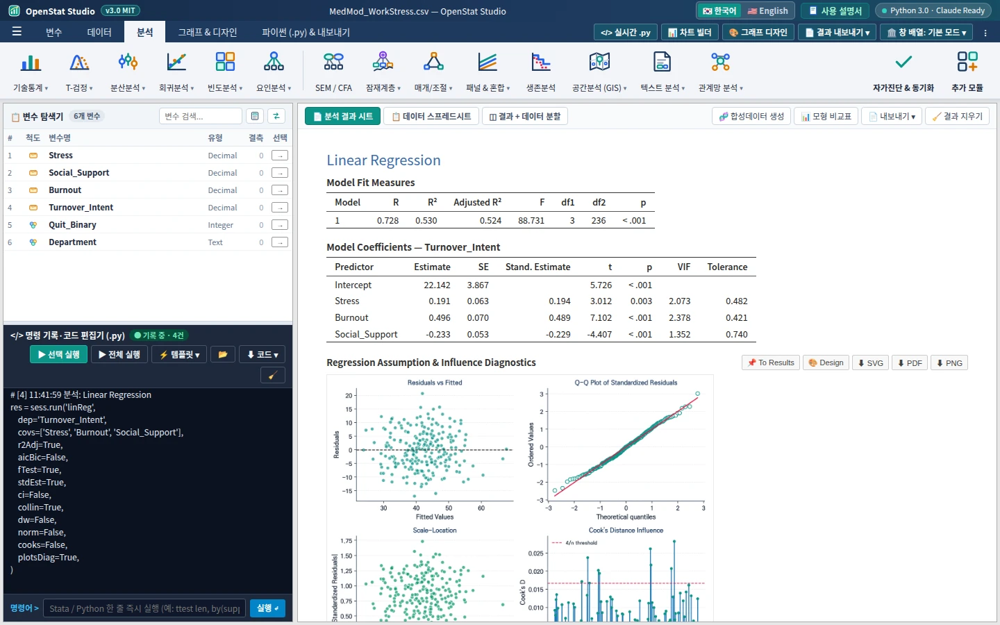</a></p>
<p align="center"><sub><b>Main window</b> — Variable Explorer at top left, command log / code editor at bottom left (every command since the file was loaded), Results sheet on the right</sub></p>

---

## 🖼️ Main Features at a Glance

The screenshots show results produced with the example data in `sample_data/` (screen width 1440 px). Click an image to open it at full size.

<table>
<tr>
<td width="50%" valign="top"><a href="docs/images/02_layout_jamovi.webp">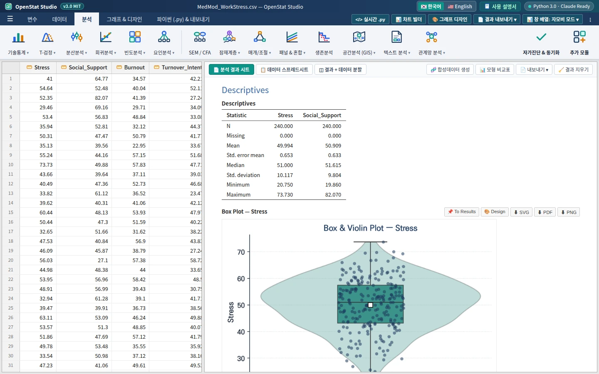</a><br><sub><b>Window layouts</b> — the jamovi layout (data on the left, results on the right), one of the six layouts in the Layout menu</sub></td>
<td width="50%" valign="top"><a href="docs/images/03_options_anova.webp">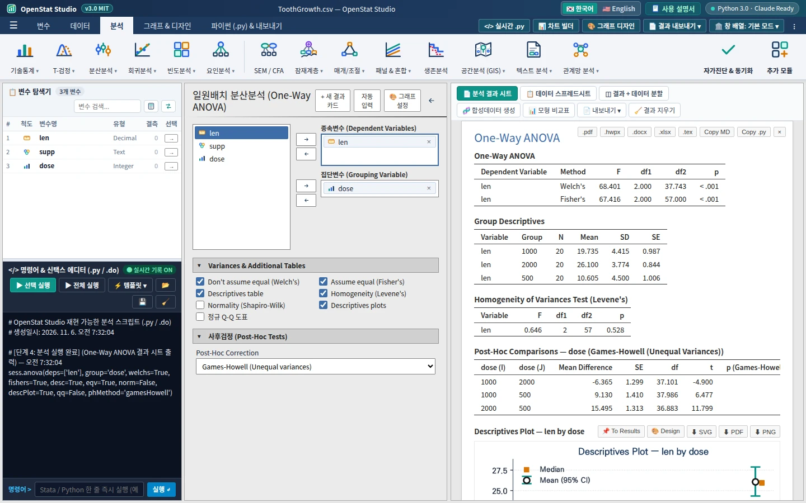</a><br><sub><b>Analysis options panel</b> — the results update as soon as variables are assigned and options chosen (one-way ANOVA, Levene's test, Games-Howell post hoc test)</sub></td>
</tr>
<tr>
<td width="50%" valign="top"><a href="docs/images/04_chart_builder.webp">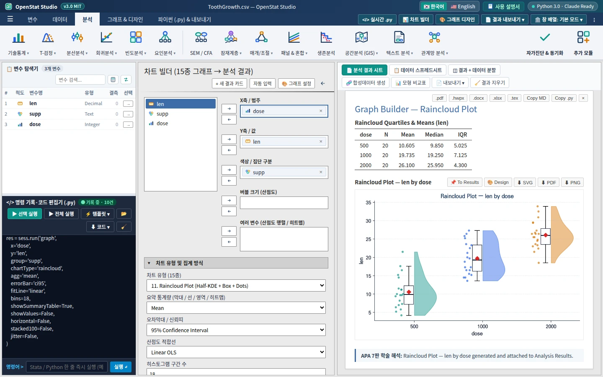</a><br><sub><b>Graph Builder</b> — 15 types of publication graphs, drawn independently of statistical tests (raincloud plot)</sub></td>
<td width="50%" valign="top"><a href="docs/images/05_plot_design.webp">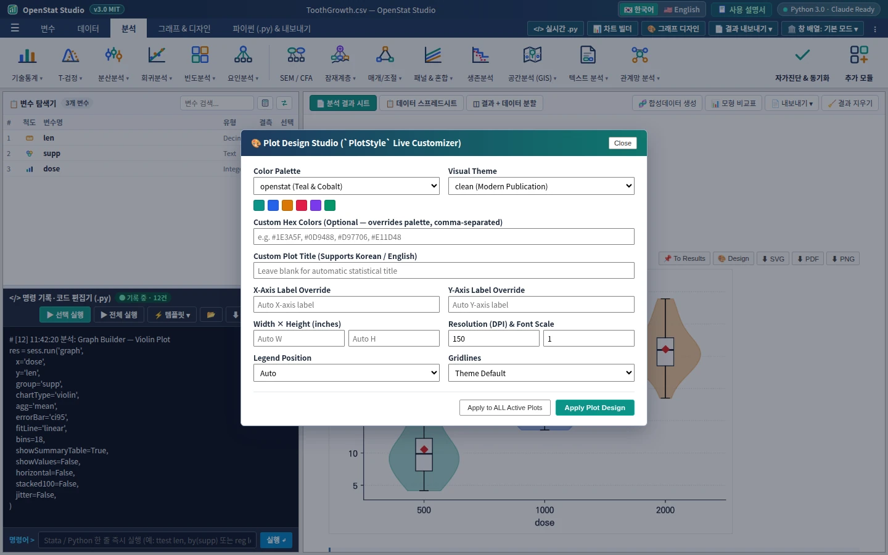</a><br><sub><b>Plot Design</b> — color palette, theme, title, axis labels, size and resolution</sub></td>
</tr>
<tr>
<td width="50%" valign="top"><a href="docs/images/06_ai_live_sync.webp">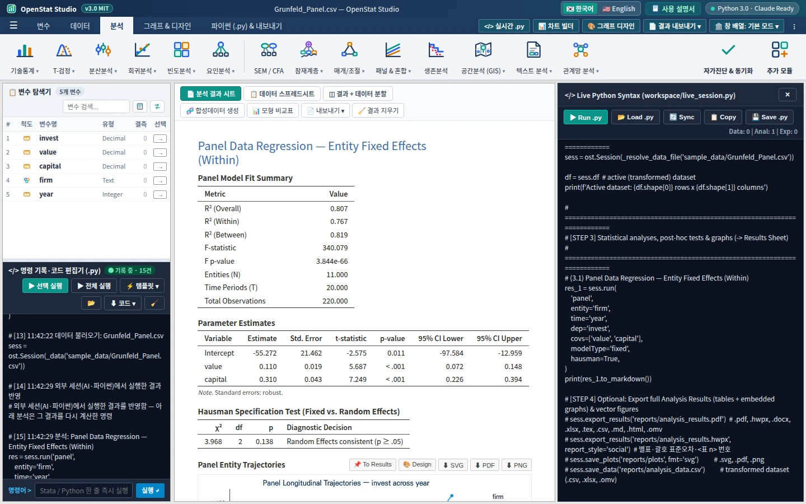</a><br><sub><b>AI and Python integration</b> — a panel fixed-effects analysis run from an outside Python session (Claude Code, SDK) appears in the results pane on its own, with the reproducible code in the live code pane on the right</sub></td>
<td width="50%" valign="top"><a href="docs/images/07_stata_syntax.webp">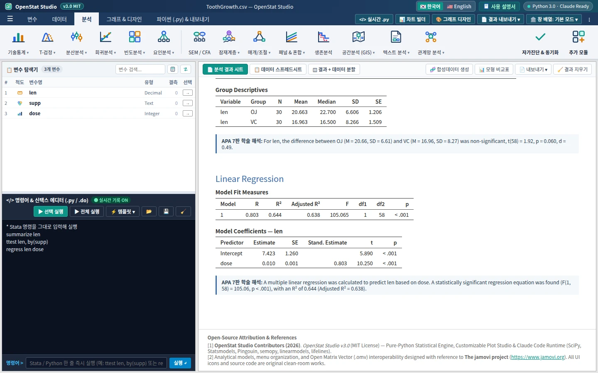</a><br><sub><b>Running Stata commands</b> — Stata commands such as summarize, ttest and regress typed as they are into the command log / code editor and run</sub></td>
</tr>
<tr>
<td width="50%" valign="top"><a href="docs/images/08_compare_modal.webp">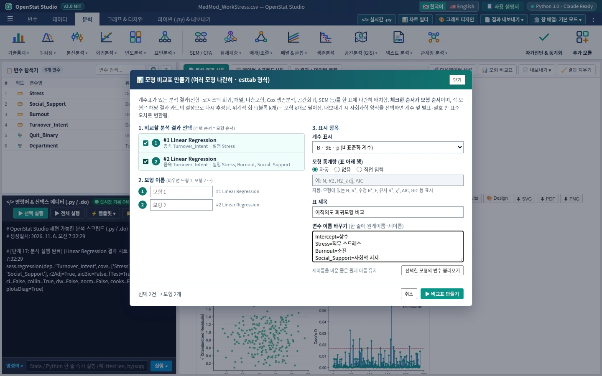</a><br><sub><b>Model comparison table settings</b> — choosing the regression models to compare, and setting model names, variable names and the statistics shown</sub></td>
<td width="50%" valign="top"><a href="docs/images/09_compare_table.webp">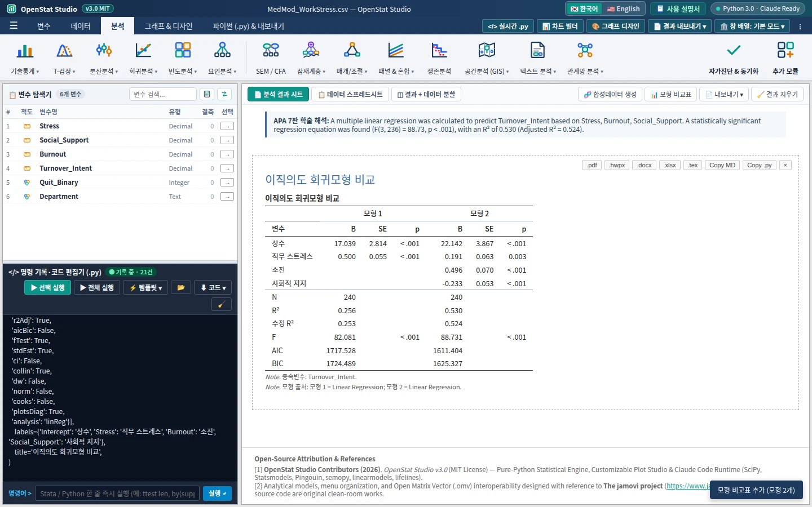</a><br><sub><b>Model comparison table output</b> — a model comparison table in the Stata esttab layout (N, R², adjusted R², F, AIC and BIC at the bottom)</sub></td>
</tr>
<tr>
<td width="50%" valign="top"><a href="docs/images/10_report_style.webp">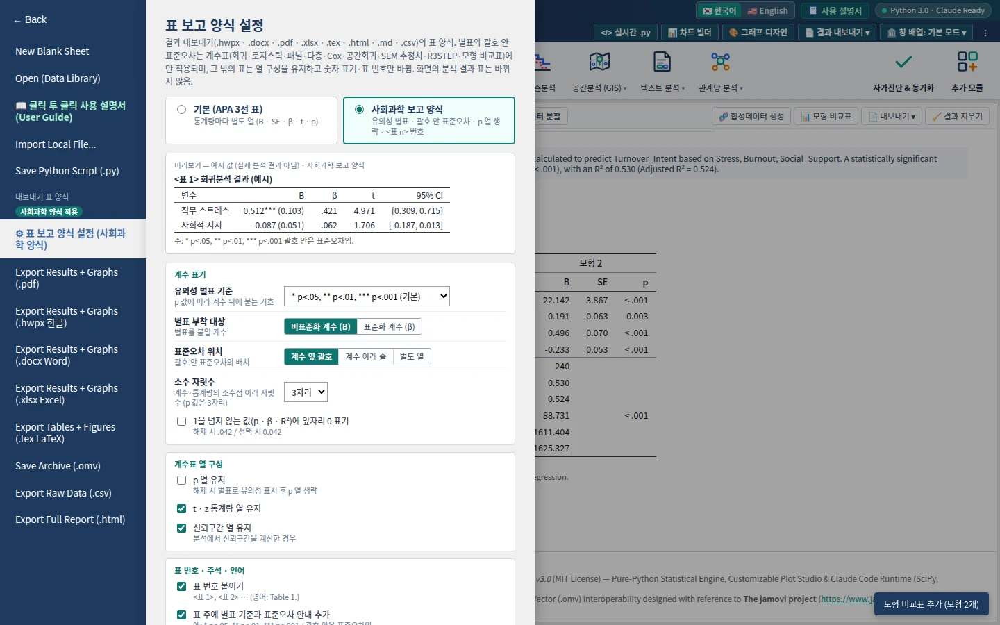</a><br><sub><b>Table report style</b> — choosing between the default APA style and the social-science report style (significance stars, standard errors in parentheses, numbered captions <code>&lt;표 n&gt;</code>), with a preview</sub></td>
<td width="50%" valign="top"><a href="docs/images/11_sem_builder.webp">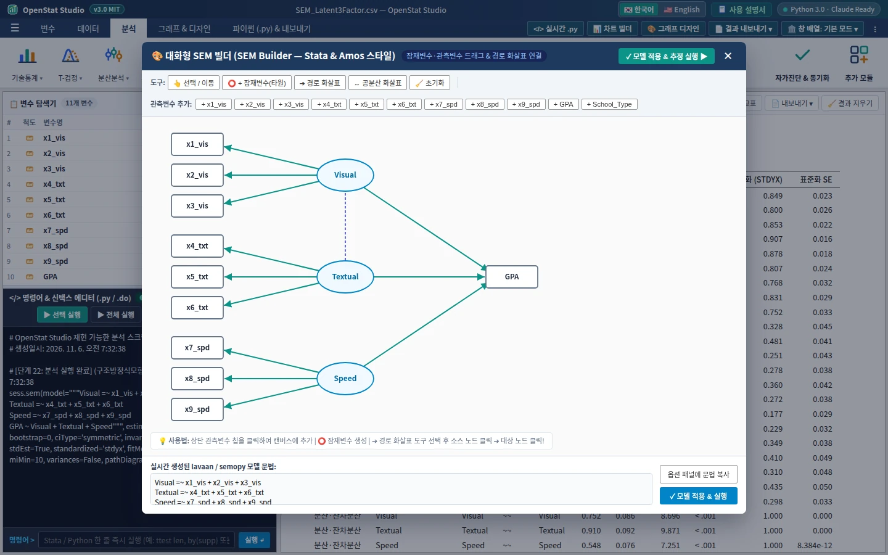</a><br><sub><b>SEM Builder</b> — draw latent variables, observed variables and paths, and the model specification is written for you</sub></td>
</tr>
<tr>
<td width="50%" valign="top"><a href="docs/images/12_sem_results.webp">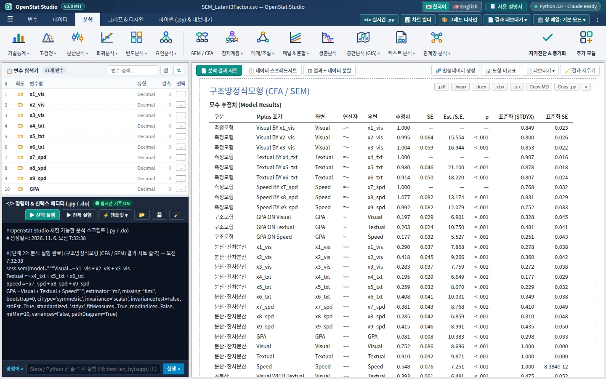</a><br><sub><b>SEM results</b> — parameter estimates labeled in Mplus notation (BY, ON) and standardized estimates (STDYX)</sub></td>
<td width="50%" valign="top"><a href="docs/images/13_lca_profile.webp">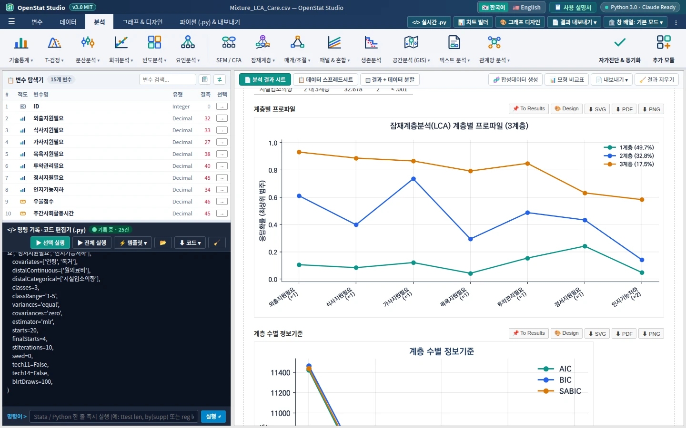</a><br><sub><b>Latent class analysis</b> — item-response probability profiles by class and information criteria (AIC, BIC, SABIC) by number of classes</sub></td>
</tr>
<tr>
<td width="50%" valign="top"><a href="docs/images/14_gis_lisa.webp">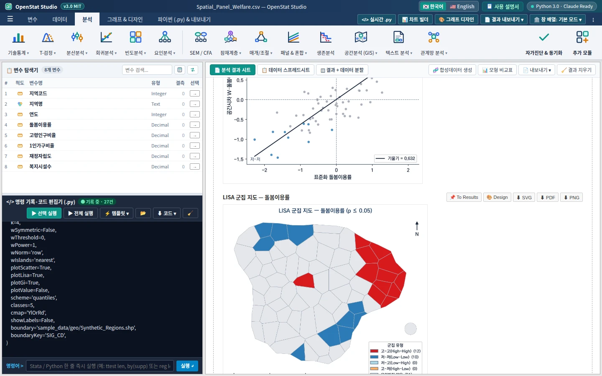</a><br><sub><b>GIS spatial analysis</b> — Moran scatter plot and LISA cluster map (map boundary file attached automatically)</sub></td>
<td width="50%" valign="top"><a href="docs/images/15_text_network.webp">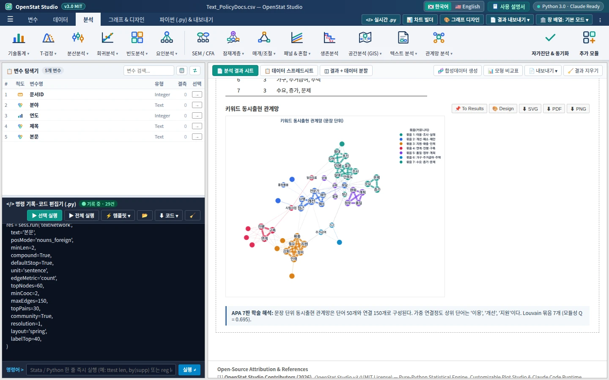</a><br><sub><b>Text analysis</b> — keyword co-occurrence network of policy documents with Louvain communities</sub></td>
</tr>
<tr>
<td width="50%" valign="top"><a href="docs/images/16_synthetic_data.webp">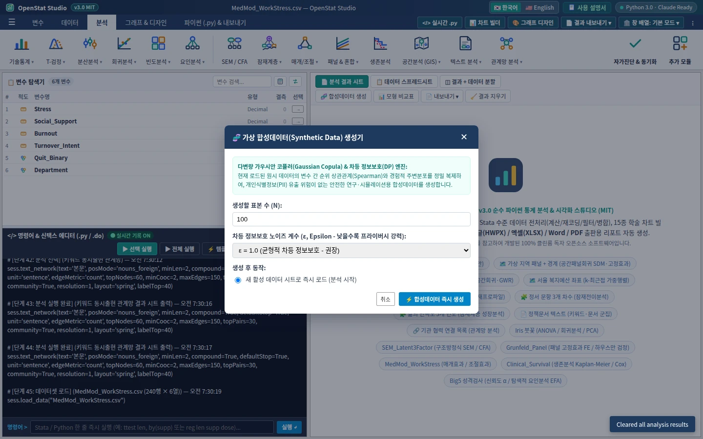</a><br><sub><b>Synthetic Data</b> — artificial data that follow the rank correlations between variables and the marginal distributions of the current dataset; the noise level (ε) can be set</sub></td>
<td width="50%" valign="top"><a href="docs/images/17_data_merge.webp">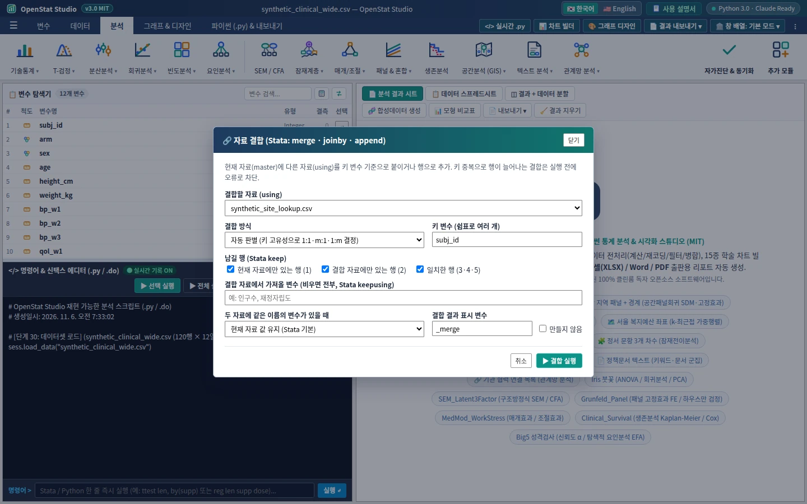</a><br><sub><b>Merge Data</b> — merging datasets in the manner of Stata merge (1:1, m:1 or 1:m detected automatically; _merge indicator variable)</sub></td>
</tr>
<tr>
<td width="50%" valign="top"><a href="docs/images/18_doctor.webp">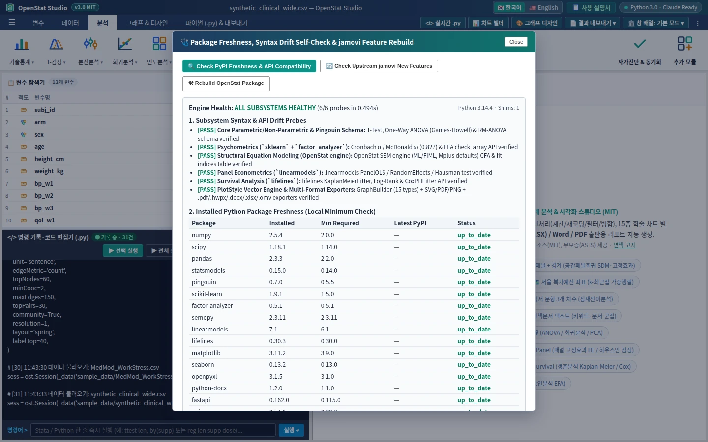</a><br><sub><b>Doctor</b> — checks of the statistical engine's subsystems and API compatibility, and of whether the installed packages are up to date</sub></td>
<td width="50%" valign="top"><a href="docs/images/19_hwpx_output.webp">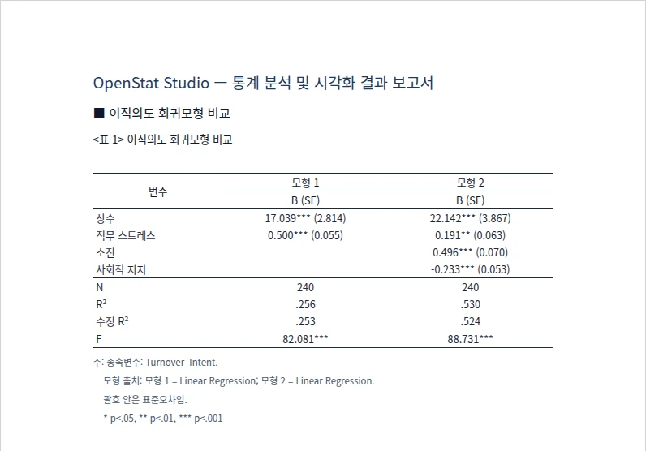</a><br><sub><b>Hangul (.hwpx) output</b> — a model comparison table saved in the social-science report style (rendered with the python-hwpx preview; fonts and spacing may differ from what Hancom Office shows)</sub></td>
</tr>
</table>


---

## ⚡ Quick Start (Three Ways to Use It)

There are three ways to run OpenStat Studio: for general users, for users of AI agents, and for Python users.

### 🌟 Option 1. General Users (One-Click Launch, No Manual Setup)
Open the graphical (GUI) program with a few clicks, without typing terminal commands.

1. On the GitHub repository page, click **[Code] → [Download ZIP]** at the top right, download the file and unzip it into a folder of your choice.
2. **Double-click the launcher**:
   - **Windows**: double-click `OPENSTAT_실행.bat` (or `START_OPENSTAT.bat`)
   - **macOS / Linux**: run `./START_OPENSTAT.sh` in a terminal
3. **Automatic setup and launch**:
   - If Python is installed, the first run sets up the virtual environment (`.venv`) and the required packages, then opens the program in its own browser window (`http://localhost:8500`).
   - From the second run on, setup is skipped and the program starts right away.
   - *To quit*: close the black console window, or press any key in it; this stops the server.
   - *Running from a shared folder*: when started from a network shared folder, the program is copied to `%USERPROFILE%\OpenStatStudio` on the local PC and run from there.

---

### 🤖 Option 2. AI Agent Users (Analyzing Data by Talking to Claude Code)
Open an AI agent such as **Claude Code**, Antigravity or Cursor in a terminal, and analyze data and produce reports by describing what you want.

#### Running and Analyzing Directly in the Claude Code Desktop App (Recommended)

1. In the **Code** tab of the Claude desktop app, start a new session and choose **this program folder** (the unzipped folder) as the working folder
2. Type `Run the program and start an analysis` (in Korean: `프로그램 실행하여 분석 시작`) in the input box → Claude follows the steps in the folder's instruction file (`CLAUDE.md`, section 0). It does not read through the whole folder; the first time only, it sets up the runtime environment (1–2 minutes), and then it opens the program in **your computer's default browser**
3. Say which file to analyze and what you want to find out (e.g., *"Open D:\\research\\survey.xlsx, compare satisfaction across age groups with an ANOVA, and use Games-Howell for the post hoc tests"*) → the results appear in the browser right away, and every command is added to `workspace/command_log.py`
4. You can also ask for exports and code conversion, e.g., *"Save the results as a Hangul (.hwpx) file and give me the command log as a Stata do-file as well"*
5. When you are done, type `Quit the program` (in Korean: `프로그램 종료`) → Claude shuts down the program (server) it started

#### Using It in a Terminal

1. **One-click setup**:
   - **Windows**: double-click `SETUP_CLAUDE_CODE.bat`
   - **macOS / Linux**: run `./SETUP_CLAUDE_CODE.sh`
   - *(or with Python: `python scripts/setup_claude_code.py`)*
2. **Start Claude Code and give instructions in plain language**:
   Run `claude` in the terminal and type what you want, for example:
   > *"Load sample_data/ToothGrowth.csv, run t-tests by dose, and make an APA table and a box plot"*  
   > *"Run a fixed-effects analysis of the panel data in Grunfeld_Panel.csv and save the result tables as HWPX and Excel files"*  
   > *"Keep only people aged 65 or older and cross-tabulate hypertension prevalence"*  
3. Claude Code runs OpenStat's 66 statistical analyses, the 15 graph types, data transformations (Recode/Filter/Reshape/Compute) and exports to Hangul (HWPX), Excel (XLSX), Word (DOCX) and PDF directly, as you go.

---

### 💻 Option 3. Python Users and Data Scientists (`import openstat as ost`)
Write analysis code in Jupyter Notebook, Google Colab or a Python script.

```python
import openstat as ost

# 1. Load data (CSV, Excel, OMV, Parquet)
sess = ost.Session("sample_data/Grunfeld_Panel.csv")

# 2. Prepare the data (the equivalent of a Stata do-file)
sess.compute("inv_cap_ratio", "invest / capital")
sess.filter("year >= 1940")

# 3. Panel analysis (entity fixed effects + Hausman test)
res = sess.panel(
    entity="firm", time="year", dep="invest", covs=["value", "capital"],
    model_type="fixed", hausman=True,
    plotStyle={"palette": "kihasa", "theme": "apa_classic", "title": "패널 고정효과 모형 추세선"}  # title: "Panel fixed-effects model trend line"
)

# 4. Export result tables in any of 11 formats, and vector graphs
res.export_results("reports/panel_report.hwpx")  # Hangul (OWPML) native tables + embedded figures
res.export_results("reports/panel_report.xlsx")  # Excel tables in APA three-line format
res.export_results("reports/panel_social.hwpx", report_style="social")  # social-science report style: 0.512*** (0.103), <표 n> numbering
res.save_plot("reports/panel_plot.svg")          # vector SVG for publication
sess.save_py("reports/analysis_script.py")       # Python script that reproduces the analysis
```

---

## 📋 Prerequisites

- **Python 3.10 or later** (recommended: Python 3.11, 3.12, 3.13, 3.14)
- **Notes for Windows users**:
  - If Python is not installed, download and install it from [python.org/downloads](https://www.python.org/downloads/).
  - **★ Be sure to tick the `[Add python.exe to PATH]` check box at the bottom of the installer window.**
  - If `OPENSTAT_실행.bat` cannot find Python, it opens the download page and shows instructions.
  - When run from a shared folder (network drive), the program is copied to, or updated in, `%USERPROFILE%\OpenStatStudio`, and the local copy is run (to change the location, set the environment variable `OPENSTAT_LOCAL_DIR`). Files changed on the source PC (for example PC2) are picked up at the next run.
  - The server listens only on `127.0.0.1:8500`, and its log is written to `workspace\server.log`.

---

## 🏛️ License and Attribution

**OpenStat Studio** is an open-source project distributed under the [MIT License](LICENSE).

- **Reference program**: The analysis menu layout, the result table style and the `.omv`-compatible file structure were designed with reference to [jamovi](https://www.jamovi.org). See [`NOTICE.md`](NOTICE.md) for details
- **GPL dependencies**: Some analysis modules load GPL-licensed packages at run time (`pingouin` GPL-3.0, `factor_analyzer` GPL-2.0). The repository source code does not include these packages; anyone who bundles them for redistribution must follow the applicable GPL terms. See Section 3.2 of [`NOTICE.md`](NOTICE.md) for details.
- **Disclaimer**: See [Disclaimer and Terms of Use](#disclaimer)

---

## 🔬 Features in Detail (v3.0)

### 1. Statistical Engine in Pure Python (66 Analyses)
- **Descriptive statistics and exploration**: summary statistics, violin and raincloud plots, scatterplots (LOESS smoother + marginal density plots or box plots), Pareto charts, Q-Q plots.
- **T-tests and ANOVA**: independent samples, paired samples and one sample t-tests; Welch's and Fisher's one-way ANOVA; factorial ANOVA (Type I/II/III sums of squares, $\eta^2$, $\eta^2_p$, $\omega^2$); ANCOVA; repeated measures ANOVA (Mauchly's test of sphericity + Greenhouse-Geisser/Huynh-Feldt corrections); Kruskal-Wallis; **five post hoc tests** (Tukey HSD, Games-Howell, Scheffé, Bonferroni, Holm).
- **Regression and categorical data**: correlation matrix, partial correlation, OLS multiple linear regression (VIF for collinearity, Durbin-Watson for independence of residuals, Cook's distance, 2×2 diagnostic plots), binomial logistic regression (odds ratios, ROC curve and AUC), contingency tables ($\chi^2$, Fisher's exact test, Cramér's $V$).
- **Instrumental variables, limited dependent variable and count models (Stata features and defaults as the reference; built on statsmodels and linearmodels)**: instrumental-variables regression by 2SLS, LIML and GMM (ivregress; first-stage diagnostics, minimum eigenvalue statistic, Stock–Yogo critical values; tests of endogeneity and of overidentifying restrictions), binary logit, probit and cloglog (average marginal effects, classification table, Hosmer–Lemeshow goodness-of-fit test), ordered logit and probit (Brant test), multinomial logit (mlogit), tobit and truncated regression, the Heckman selection model (maximum likelihood, two-step) and heckprobit, count-data regression (Poisson, negative binomial NB2 and NB1, zero-inflated zip and zinb, truncated tpoisson and tnbreg, hurdle; IRRs, marginal effects, observed vs. predicted frequencies).
- **Psychometrics and factor analysis**: reliability analysis (Cronbach's $\alpha$, McDonald's $\omega$), principal component analysis (PCA), exploratory factor analysis (EFA: MinRes / ML / principal axis extraction + Varimax / Promax / Oblimin rotation + scree plot with parallel analysis).
- **Structural equation modeling (SEM / CFA, Mplus defaults)**: an estimation engine that computes with numpy and scipy the defaults of the Mplus User's Guide (Eighth Edition, Chapters 16–18) and the published estimation methods (ML and MLR: Yuan–Bentler; MLM: Satorra–Bentler 1994; categorical: Muthén 1984, Muthén, du Toit & Spisic 1997, Asparouhov & Muthén 2010), compared with Mplus 8.8 output and lavaan results for 22 published examples of the Mplus User's Guide (`tests/test_sem_mplus_examples.py`). WLSMV, WLSM, WLS, ULSMV and ULS estimation for binary and ordered variables (Mplus CATEGORICAL) (delta and theta parameterization, thresholds, scale factors `y ~*~ y`, categorical latent growth models, adjusted χ²) and MLM (Satorra–Bentler); model templates for cross-lagged (CLPM, RI-CLPM, multiple-indicator latent CLPM), latent growth (linear, quadratic, latent basis, conditional, parallel process, second-order factor) and latent change score models (name the variables and a model with the standard assumptions written in is generated, `sess.sem_template`). Models are specified with a model string (`=~`, `~`, `~~`, `~ 1`, `a*x` labels, `1*x` fixed values, `:=` defined parameters, `==` constraints) and Python options. ML (default) and MLR (sandwich SEs, Yuan–Bentler scaled χ²), FIML for missing data (default), mean structure, conditional treatment of exogenous observed variables, multiple groups (default: loadings and intercepts held equal) with step-by-step measurement invariance comparison, indirect effects (MODEL INDIRECT; delta method and bootstrap confidence intervals), modification indices (MODINDICES), STDYX, STDY and STD standardization, R², model fit (χ², RMSEA with 90% CI, CFI, TLI, SRMR, AIC, BIC, SABIC), path diagram.
- **Latent class and mixture models (Mplus defaults)**: latent class analysis (LCA), latent profile analysis (LPA), latent transition analysis (LTA), latent class growth analysis (LCGA). MLR, STARTS 20 4, FIML, comparison of the number of classes (AIC, BIC, SABIC, entropy), Vuong–Lo–Mendell–Rubin LRT and Lo–Mendell–Rubin adjusted LRT (TECH11), parametric bootstrapped LRT (TECH14), classification accuracy, three-step auxiliary analysis (R3STEP, BCH, DCAT), posterior probabilities for each case.
- **Panel econometrics, time series and multilevel models**: panel data summaries (xtdescribe, xtsum, xttab, xttrans); the xtreg family (fixed effects, two-way fixed effects, random effects, correlated random effects (Mundlak, `xtreg, cre`), between, first-difference, pooled, population-averaged); robust, cluster–robust and Driscoll–Kraay standard errors; Hausman (sigmamore, sigmaless), Mundlak, joint test of time effects (testparm), Breusch–Pagan LM, Wooldridge, Pesaran CD and modified Wald tests; saving predictions (`predict` xb, u, e, ue, xbu, stdp); nonlinear panel models (xtlogit, xtprobit, xtcloglog, xtpoisson, xtnbreg, xttobit, xtintreg, xtologit, xtoprobit, clogit: conditional fixed effects, random effects by adaptive Gauss–Hermite quadrature, GEE population-averaged models; Hausman test, average marginal effects); panel FGLS, panel-corrected standard errors and AR(1) disturbances (xtgls, xtpcse, xtregar) and the Hausman–Taylor estimator (xthtaylor); difference in differences and event studies (xtdidregress, xthdidregress: parallel-trends test, Callaway–Sant'Anna RA, IPW and AIPW, extended TWFE, aggregation); panel unit-root tests (xtunitroot: LLC, HT, Breitung, IPS, Fisher, Hadri) and cointegration tests (xtcointtest: Kao, Pedroni, Westerlund); dynamic panel GMM (Arellano–Bond difference GMM, Blundell–Bond system GMM, Windmeijer bias-corrected robust VCE, AR, Sargan and Hansen tests); panel instrumental variables (xtivreg FE, RE G2SLS/EC2SLS, FD, BE); ARIMA, seasonal ARIMA, ARMAX, unit-root tests (ADF, PP, KPSS) and autocorrelation; multilevel models with 2–4 levels (random slopes and covariance structures at each level, ML, REML, ICC, multilevel logistic and Poisson models).
- **Bayesian statistics and survival analysis**: JZS (Cauchy prior) Bayesian t-test, ANOVA and correlation ($BF_{10}$), bootstrap mediation analysis (direct, indirect and total effects with 95% confidence intervals), moderation (simple slopes), Kaplan-Meier survival curves and the Cox proportional hazards model.

### 2. Data Management Ribbon and Dialogs (Stata `.do`-File Style)
- **Variables view**: each variable's measure type (nominal/ordinal/continuous), data type, number of missing values and summary statistics (mean ± standard deviation, or the list of categories), with delete and recode buttons for each variable.
- **Data management buttons**:
  - `[Compute]`: create a new variable from a Python expression (`weight / (height/100)**2`)
  - `[Recode]`: recode by ranges or single values and assign labels (dialog)
  - `[Filter]`: keep the rows that meet a condition (`age >= 20 and gender == 1`)
  - `[Merge Data]`: combine two datasets on key variables (Inner, Left, Right, Outer)
  - `[Reshape]`: convert wide $\leftrightarrow$ long
  - `[Transform (Z)]`: standardize (z-score, min-max, robust)
  - `[Undo]`: undo the last step and restore the previous state

### 3. Standalone Graph Builder with 15 Chart Types for Papers (`GraphBuilder`)
Draws charts for papers independently of statistical tests and adds them to the Results sheet:
- `bar`, `stacked_bar`, `line`, `area`, `pie`, `donut`, `histogram`, `density`, `box`, `violin`, `raincloud`, `scatter` (bubbles + OLS/LOESS fit line), `pairplot`, `heatmap`, `errorbar` (forest plot of CIs).

### 3-1. Text and Network Analysis (Ribbon [Text Mining] · [Networks])
- **Importing text files**: `.txt` `.md` `.docx` `.pdf` `.hwpx` files or folders → one document = one row of data (columns 문서ID·파일명·폴더·형식·글자수·본문: document ID, file name, folder, format, character count, text). SDK: `ost.load_texts("folder")`
- **Keyword analysis** (`textKeywords`): kiwipiepy morphological analysis, user dictionary, stopwords and synonym merging, tables of frequency, document frequency and TF-IDF, distinctive keywords by group (c-TF-IDF), word cloud
- **Keyword co-occurrence network** (`textNetwork`): co-occurrence within sentences or documents, link strength by frequency, Jaccard or NPMI, centrality, Louvain communities, network plot
- **Document clustering** (`textCluster`): TF-IDF + LSA (default) or sentence embeddings (`BAAI/bge-m3` and others; optional installation of `requirements-embedding.txt`) → UMAP → HDBSCAN, k-means or Ward; representative keywords of each cluster (c-TF-IDF), reassignment of unclustered documents, higher-level topic groups, stability across three seeds (ARI), cluster map, cluster network and document similarity network
- **Network analysis** (`graphNetwork`): edge list (source, target, weight) → density, path length, clustering coefficient, six centrality measures (degree, weighted degree, betweenness, closeness, eigenvector, PageRank), Louvain communities, network plot
- Example data: `sample_data/Text_PolicyDocs.csv` (150 synthetic policy documents), `sample_data/Network_Collaboration.csv` (86 synthetic collaborations between organizations)

### 3-2. GIS Spatial Analysis (Ribbon [Spatial (GIS)] · Data Tab [Link Boundary])
- **Linking map boundaries**: link a `.shp` (+`.shx` `.dbf`, optional `.prj` `.cpg`), `.zip`, `.geojson` or `.gpkg` file to the region codes in the data (key variable suggested automatically, match rate shown), or open the boundary attribute table as data. Korean attribute tables without a `.cpg` file are read as CP949. Coordinates alone (longitude, latitude) are also enough for analysis
- **Spatial weights matrix** (`spatialWeights`): queen and rook contiguity (orders 1–3), k-nearest neighbors, distance band, inverse distance, external files (.gal, .gwt, .csv) / row standardization, spectral (Stata default) and min-max normalization / regions without neighbors (connect to the nearest, exclude, keep) / connectivity map; saved as `.gal`, `.gwt` or `.csv` for Stata `spmatrix fromdata`
- **Spatial autocorrelation** (`spatial_moran`): global Moran's I (normal approximation, permutation), LISA clusters (conditional permutation, FDR and Bonferroni adjustment), Getis–Ord Gi* hot spots and cold spots, choropleth maps (quantiles, natural breaks, equal intervals)
- **Cross-sectional spatial regression** (`spatial`, Stata `spregress`): maximum likelihood estimation of OLS, SLX, SAR, SEM, SDM, SDEM and SAC models; OLS diagnostics (Moran's I of residuals, LM and robust LM tests, Jarque–Bera, Koenker–Bassett, condition number); comparison of seven models and LR tests; direct, indirect and total effects (delta method, simulation); OIM and EIM standard errors
- **Spatial panel regression** (`spatialPanel`, Stata `xsmle`, `spxtregress`): region, time and two-way fixed effects (Lee–Yu correction), random effects (SAR, SDM), Hausman test, panel LM tests, effects decomposition, balanced panel built automatically
- **Geographically weighted regression** (`gwr`, mgwr): bisquare, Gaussian and exponential kernels, adaptive and fixed bandwidths, bandwidth selection by AICc, significance adjusted for the effective number of parameters, maps of local coefficients, Monte Carlo test of spatial variability
- The first table of every result records the **assumptions and settings of the analysis** (basis of the weights matrix, normalization, treatment of isolated regions, model, panel effects, bias correction, type of standard errors)
- Checks: cross-sectional SAR, SEM, SDM and SDEM coefficients, log likelihoods and EIM standard errors, LM tests, and panel fixed-effects and random-effects SAR estimates match PySAL `spreg` (`tests/test_spatial.py`)
- Example data (synthetic): `sample_data/geo/Synthetic_Regions.shp` (73 fictional regions), `Spatial_Panel_Welfare.csv` (73 regions × 8 years), `Spatial_CrossSection_Welfare.csv` — the boundaries are attached automatically when an example dataset is opened
- SDK: `sess.attach_boundary("boundary.shp", key="SIG_CD", data_key="지역코드")` → `sess.spatial_panel(dep=..., covs=[...], timeVar="연도", model="sdm", effectsType="fe", feType="both")` (columns 지역코드 = region code, 연도 = year)

### 4. Exporting Result Reports in 11 Formats (Statistical Tables + High-Resolution Figures)
- **`.hwpx`**: Hangul (OWPML) native editable tables (`<hp:tbl>`) **+ embedded PNG figures (`<hp:pic>`)**
- **`.pdf`**: report with APA three-line tables and high-resolution graphs
- **`.docx`**: Microsoft Word native APA tables + charts
- **`.xlsx`**: Excel sheets with APA borders + a sheet of chart images
- **`.tex`**: LaTeX `booktabs` tables + a set of vector PDF figures for `\includegraphics`
- **`.html`**, **`.md`**, **`.csv`**, **`.tsv`**, **`.json`**, **`.omv`**
- **Social-science report style (`report_style="social"`)**: on regression-type coefficient tables only, adds significance stars (`* p<.05, ** p<.01, *** p<.001`, optionally `†`), puts standard errors in parentheses beside or below the coefficients, drops the p column and drops the leading zero of values that cannot exceed 1; adds numbered captions (`<표 n>`) and merged cells for grouped headers to every table. For Excel, a raw-values sheet for calculation is saved as well
- **Model comparison table (`sess.compare_models`)**: a table in the Stata `esttab` layout that places several models (or the blocks of a hierarchical regression) side by side in columns, with N, R², AIC and other statistics below

---

## 🛠️ Self-Check and Maintenance CLI (`openstat`)

```bash
# 1. Check whether packages are up to date and whether upstream APIs have changed (Doctor)
.venv/bin/openstat doctor        # Linux / macOS
.venv\Scripts\openstat doctor    # Windows

# 2. Check the reference program (jamovi) for new analyses and rebuild
.venv/bin/openstat sync-jamovi
.venv/bin/openstat rebuild

# 3. List all analysis modules and color palettes
.venv/bin/openstat catalog
.venv/bin/openstat palettes
```

---

## 📁 Project Folder Structure

```
OpenStat-Studio/
├── OPENSTAT_실행.bat        # [Windows] one-click launcher with automatic setup
├── START_OPENSTAT.bat       # [Windows] starts the local server and opens the app window
├── STOP_OPENSTAT.bat        # [Windows] stops the background server
├── START_OPENSTAT.sh        # [macOS/Linux] launcher with automatic setup
├── STOP_OPENSTAT.sh         # [macOS/Linux] stops the server
├── SETUP_CLAUDE_CODE.bat    # [Windows] one-click Claude Code AI setup
├── SETUP_CLAUDE_CODE.sh     # [macOS/Linux] Claude Code AI setup
├── .mcp.json                # Claude Code MCP settings (created on each PC by SETUP_CLAUDE_CODE; not tracked by Git)
├── CLAUDE.md                # Instructions for the Claude Code agent
├── README.md                # Guide (Korean)
├── README_EN.md             # Guide (English)
├── README_KR.md             # Detailed Korean manual
├── NOTICE.md                # Open-source attribution and license notices
├── LICENSE                  # Full text of the MIT License
├── requirements.txt         # Package dependencies
├── setup.py                 # pip installation and CLI registration
├── docs/                    # User guides (user_guide.html, user_guide_en.html) and screenshots (images/)
├── reconstructed/           # Python source code
│   ├── pyjamovi/            # Statistical engine, data management, visualization, web UI
│   │   ├── analyses/        # Statistical analysis modules
│   │   ├── data_ops.py      # Stata-style data transformation engine
│   │   ├── exporters/       # Export engines for 11 formats
│   │   └── web/             # Web interface (UI) and SVG icons
│   └── openstat/            # openstat namespace and CLI/MCP entry points
├── sample_data/             # Practice datasets for panel models, SEM, ANOVA and more
└── workspace/               # Command log (command_log.py) and live sync (live_session.py)
```

---

<a id="disclaimer"></a>

## ⚠️ Disclaimer and Terms of Use

This notice applies in addition to the disclaimer of warranty and limitation of liability in the [MIT License](LICENSE). By downloading or using this program, you are deemed to have accepted this notice.

1. **Developer**: This program is open-source software developed and published by an individual developer in a personal capacity. It has no connection with any official product, service or view of the organization the developer works for or of any third party
2. **No warranty**: The program and its documentation are provided "AS IS". No warranty of any kind, express or implied, is given as to accuracy, completeness, merchantability, fitness for a particular purpose, error-free operation or continued availability
3. **Responsibility for checking results**: The user is responsible for interpreting and using analysis results (estimates, test statistics, figures, exported documents). Before results are used for an important purpose, such as academic publication, policy decisions, or clinical, legal or financial judgments, they must be cross-checked with other validated software or by expert review. Features that carry the name or default settings of other software (e.g., "Mplus defaults", "Stata merge style") are not guaranteed to give the same results as that software either
4. **Limitation of liability**: To the maximum extent permitted by applicable law, the developer and contributors are not liable for any direct, indirect, incidental, special or consequential damages arising from the use of or inability to use this program, program errors, differences in results, data loss or file corruption, or connections to third-party services
5. **Data and personal information**: The user is responsible for collecting, using, storing and destroying the data they load and process in a lawful manner (including under Korea's Personal Information Protection Act and Statistics Act, research ethics rules and Institutional Review Board regulations). Analyses run on the user's PC, but the following functions communicate with external servers: package installation and update checks (PyPI), checks for new features of the reference program (GitHub) and downloads of sentence-embedding models (Hugging Face). When the program is used together with external AI tools such as Claude Code, data and results may be sent to the provider of that service, and their handling is governed by that service's terms. For sensitive data, users must check their institution's rules before connecting AI tools
6. **Synthetic data**: The synthetic data function does not guarantee that de-identification is adequate or that re-identification is impossible. Before synthetic data are published or taken outside, a separate assessment under the relevant standards is required
7. **Trademarks and third-party rights**: Product names and trademarks that appear in this document and in the program, such as SPSS, Stata, SAS, Mplus, jamovi, JASP, Hangul and Hancom Office, Microsoft Word and Excel, and Claude, are the property of their respective owners. This program is not affiliated with, sponsored by or endorsed by these owners, and product names are used only to describe compatibility and features
8. **Third-party software**: Third-party packages, fonts and models that this program installs or uses are subject to their own licenses. When some GPL packages (`pingouin`, `factor_analyzer`) are bundled and redistributed, the redistributor is responsible for complying with the terms of those licenses (see [NOTICE.md](NOTICE.md))
9. **Takedown and changes**: If concerns are raised that copyright, trademark or other rights are infringed, or whenever the developer considers it necessary, all or part of the repository and its distributions may be modified, made private or deleted without prior notice. The developer has no obligation to provide technical support, updates or bug fixes
10. **Reporting infringement**: If you believe that content in this repository infringes rights, please report it through [GitHub Issues](https://github.com/beaver21c/pyopenstat/issues); the report will be reviewed and acted on

**Disclaimer (English summary).** OpenStat Studio is open-source software developed and published by an individual in a personal capacity under the MIT License. It is not an official product or position of the developer's employer or of any third party. The software and its documentation are provided "AS IS", without warranty of any kind. Users are solely responsible for verifying results before relying on them (including academic publication, policy, clinical, legal or financial decisions) and for the lawful handling of their data, including data sent to third-party AI services used together with this software. To the maximum extent permitted by applicable law, the developer and contributors are not liable for any direct, indirect, incidental, special or consequential damages arising from the use of, or inability to use, the software. Product names and trademarks belong to their respective owners; no affiliation or endorsement is implied. The developer may modify, make private or remove this repository, in whole or in part, at any time without notice, including in response to rights concerns, and has no obligation to provide support or updates.
