# OpenStat Studio v3.0 한국어 사용자 가이드

🔗 **저장소** <https://github.com/beaver21c/pyopenstat> · ⬇️ **[내려받기 (ZIP)](https://github.com/beaver21c/pyopenstat/archive/refs/heads/main.zip)** · 📖 **사용 설명서** [온라인 보기](https://raw.githack.com/beaver21c/pyopenstat/main/docs/user_guide.html) / [파일](docs/user_guide.html) · ⚠️ **[면책 고지](#disclaimer)**

**AI와 연동되는 파이썬 기반 사회과학 통계 프로그램 · 통계 프로그램 형식의 작업 화면 · 한글(.hwpx) 결과 출력**

순수 파이썬 기반의 연구용 통계 분석·시각화 오픈소스 프로그램(MIT 라이선스).

---

## ✨ 주요 강점

- **AI 직접 연동**: Claude Code 등 AI 도구가 MCP 도구·명령줄(`openstat`)·파이썬 SDK로 분석을 직접 실행하고, 코드 기록과 결과 기록 파일을 읽어 수정·재실행. 외부 세션에서 실행한 분석도 열린 프로그램 화면에 자동 반영
- **통계 프로그램 형식의 작업 화면**: 변수 탐색기, 데이터 스프레드시트, 분석 옵션 창, 결과 시트, 명령 기록·코드 편집기(Stata 명령 입력 실행)를 한 화면에 배치하고 창 배열 6종 제공
- **사회과학 분석 범위**: 기술통계·t검정·분산분석·회귀·요인·신뢰도, 구조방정식(Mplus 기본 설정), 잠재계층·잠재전이·잠재계층 성장분석, 패널·다층모형, 생존·베이지안·매개·조절, GIS 공간회귀·공간패널·지리가중회귀, 텍스트·관계망 분석 등 분석 45종과 그래프 15종
- **한글(.hwpx) 출력과 보고 양식**: 결과표(한글에서 편집 가능한 표 개체)와 그림을 한글 문서로 저장. 유의수준 별표·괄호 표준오차·「<표 n>」 번호의 사회과학 보고 양식, Stata `esttab` 형식 모형 비교표 제공. Word·Excel·PDF·LaTeX 등 11개 형식 지원
- **Stata 방식 자료 관리**: merge(1:1·m:1·1:m, `_merge` 표시 변수)·reshape·recode·destring·encode, 실행 취소, .dta·.sav·.omv 입출력, 텍스트 파일·지도 경계 파일 불러오기, 합성데이터 생성
- **재현 가능한 분석 기록**: 파일 불러오기부터 실행한 모든 명령(자료 처리·분석·직접 입력 명령·내보내기)이 파이썬 파일 하나(`workspace/command_log.py`)에 순서대로 쌓여 그대로 다시 실행 가능. Stata(.do)·R(.R) 코드는 필요할 때 변환하여 받음
- **무료·로컬 실행**: MIT 라이선스로 무료 사용. 사용자 PC에서 실행되며 웹 화면은 127.0.0.1에만 연결. Windows·macOS·Linux 실행 파일 제공

## 🧭 개발 배경

**기존 방식의 한계**

- 기존 사회과학 통계 패키지(SPSS·Stata·SAS 등)는 AI와 직접 연결되는 기능이 제한적임. 패키지에서 작성한 코드와 결과를 AI 대화창에 복사해 붙여 넣고, AI가 고친 코드를 다시 패키지에 붙여 넣어 실행하는 과정의 반복이 일반적임
- 패키지마다 명령 언어(SPSS Syntax, Stata do-file, SAS 프로그램 등)가 달라 AI가 해당 언어를 충분히 다루지 못하면 오류가 발생하며, 코드 입력·수정·재실행의 반복 작업을 연구자가 직접 수행해야 함

**설계 원칙**

1. **파이썬 기반 통계 엔진**: AI가 데이터 분석 코드 작성에 주로 사용하는 파이썬으로 통계 추정·자료 처리·결과 내보내기 전 과정을 구현. AI(Claude Code 등)가 명령줄·MCP 도구·파이썬 SDK로 분석을 직접 실행하고, 코드 기록(`workspace/live_session.py`)과 결과 기록(`workspace/live_session.json`)을 읽어 결과를 확인한 뒤 수정·재실행. 같은 결과가 열린 프로그램 화면의 결과창과 코드 창에도 실시간 반영됨
2. **연구자에게 익숙한 프로그램 형식**: AI만으로 분석하면 분석 과정과 결과의 기록·관리, 시각적 점검에 한계가 있음. 이에 변수 생성·편집 화면, 결과창, 코드 작성창을 갖춘 통계 프로그램 형식으로 구성하여, 연구자가 AI의 분석 과정을 화면에서 확인·검토·수정할 수 있도록 함
3. **jamovi 참고와 분석 기법 확장**: 메뉴 구성과 결과표 양식은 jamovi를 참고함. 여기에 파이썬 라이브러리로 구현한 기법(패널 회귀, 구조방정식(Mplus 기본 설정), 잠재계층·혼합모형, GIS 공간회귀, 텍스트·관계망 분석 등)을 더해 사회과학 분야에서 통용되는 분석을 포괄함
4. **논문·보고서 작성 연계(한글 .hwpx 출력)**: 국내 논문·보고서 작성 환경을 고려하여 결과표와 그림을 한글(.hwpx) 문서로 직접 저장함. 표는 한글에서 편집 가능한 표 개체로 생성되며, 유의수준 별표·괄호 표준오차·「<표 n>」 번호를 붙이는 사회과학 보고 양식을 선택할 수 있음. SPSS·Stata·SAS·jamovi·JASP의 결과 내보내기 형식에는 한글(.hwpx)이 없어(2026년 11월 확인), 이들 패키지에서는 워드·엑셀·HTML로 내보낸 결과를 한글에서 다시 정리하는 과정이 필요함

## 🎯 활용 가능성

- **학위논문·학술논문 분석**: 분석 결과표를 한글·Word 문서로 저장하여 원고에 반영. 사회과학 보고 양식과 모형 비교표로 학술지 표 형식에 맞춘 정리 작업 축소
- **정책·연구보고서 작성**: 「<표 n>」 번호와 한글 표 개체로 국내 보고서 서식에 맞춘 결과 정리. 시군구 등 지역 단위 자료의 주제도·공간회귀, 정책문서의 키워드·주제 분석
- **AI 협업 분석**: 연구자가 분석 방향을 지시하고 AI가 실행하며, 연구자는 결과 시트와 코드 기록을 화면에서 검토·수정. 분석 이력이 코드로 남아 검증과 공동연구자 공유에 활용
- **통계·방법론 교육**: 메뉴 조작 결과가 파이썬 코드와 Stata 대응 명령으로 기록되어 화면 조작과 코드 작성 학습을 연계. 무료 배포로 실습 환경 구성 부담 축소
- **Stata·SPSS 이용자의 파이썬 환경 전환**: Stata 명령 입력 실행, Stata 자료 관리 방식(merge·reshape 등) 유지, .dta·.sav 파일 입출력
- **자료 공유와 재현성 점검**: 분석 스크립트(.py)와 작업 파일(.omv) 저장. 합성데이터로 예시 자료 작성(공개 전 재식별 위험 별도 평가 필요)

---

<a href="docs/images/01_main_default.webp">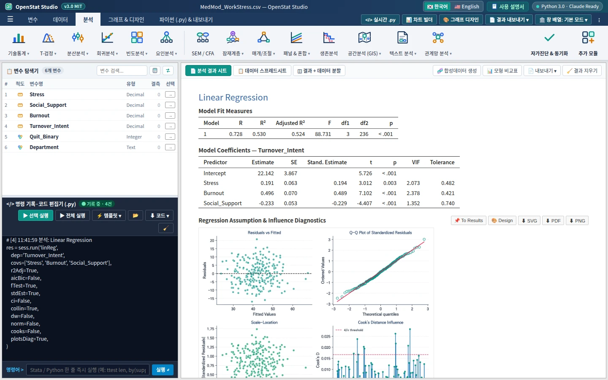</a>

<b>기본 화면</b> — 왼쪽 위 변수 탐색기, 왼쪽 아래 명령 기록·코드 편집기(파일 불러오기부터 모든 명령 누적 기록), 오른쪽 분석 결과 시트

---

## 🖼️ 화면으로 보는 주요 기능

화면 사진은 `sample_data/`의 예제 자료로 실행한 결과임(화면 폭 1440px). 사진을 누르면 원래 크기로 열림.

<table>
<tr>
<td width="50%" valign="top"><a href="docs/images/02_layout_jamovi.webp">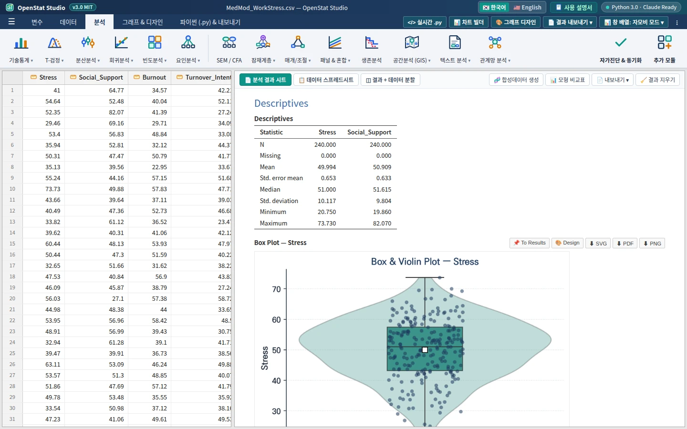</a> <b>창 배열</b> — 「창 배열」 메뉴의 6가지 배열 중 자모비 배열(왼쪽 데이터표, 오른쪽 결과)</td>
<td width="50%" valign="top"><a href="docs/images/03_options_anova.webp">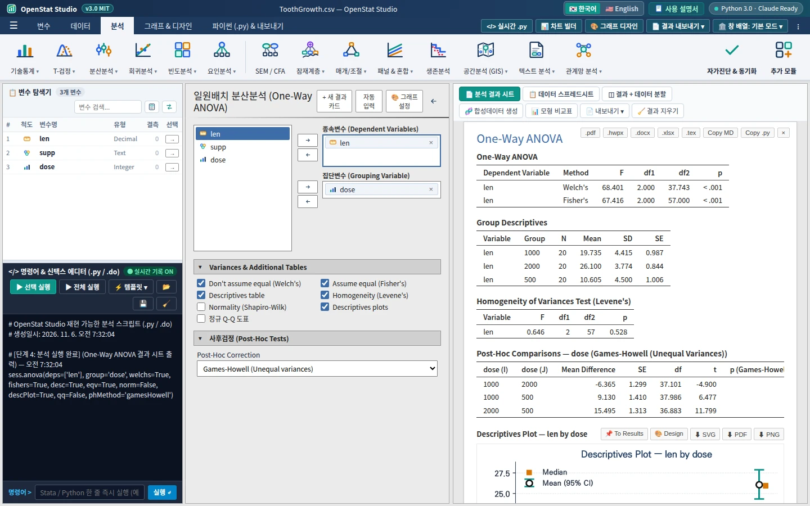</a> <b>분석 옵션 창</b> — 변수 지정·옵션 선택 즉시 결과 갱신(일원배치 분산분석, Levene 검정, Games-Howell 사후검정)</td>
</tr>
<tr>
<td width="50%" valign="top"><a href="docs/images/04_chart_builder.webp">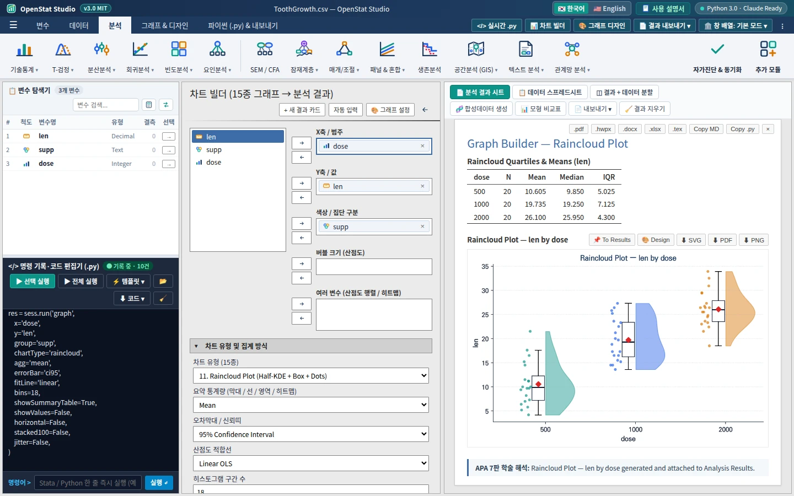</a> <b>차트 빌더</b> — 통계 검정과 별도로 15종 학술 그래프 작성(레인클라우드 그림)</td>
<td width="50%" valign="top"><a href="docs/images/05_plot_design.webp">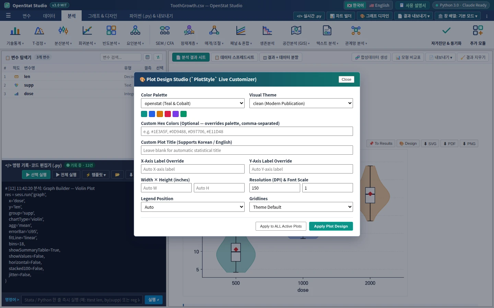</a> <b>그래프 디자인</b> — 색상 팔레트·테마·제목·축 이름·크기·해상도 지정</td>
</tr>
<tr>
<td width="50%" valign="top"><a href="docs/images/06_ai_live_sync.webp">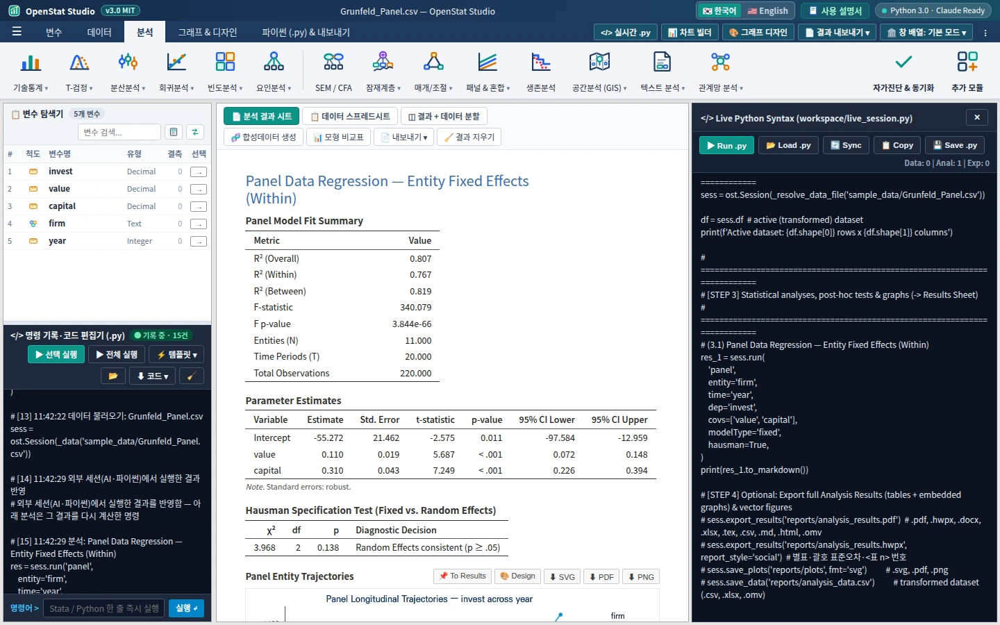</a> <b>AI·파이썬 연동</b> — 외부 파이썬 세션(Claude Code·SDK)에서 실행한 패널 고정효과 분석의 결과창 자동 반영, 오른쪽 실시간 코드 창의 재현 코드</td>
<td width="50%" valign="top"><a href="docs/images/07_stata_syntax.webp">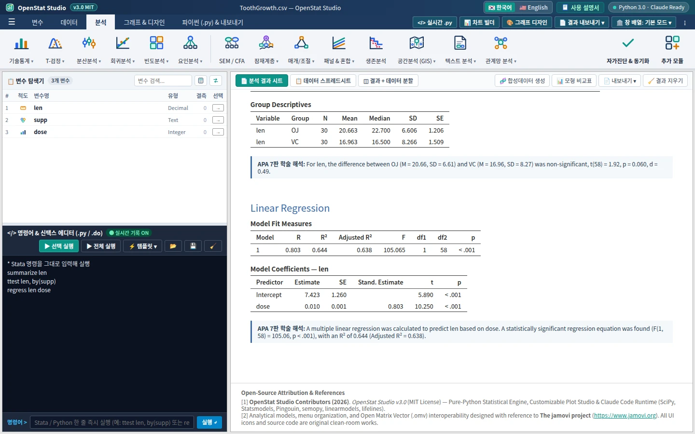</a> <b>Stata 명령 실행</b> — summarize·ttest·regress 등 Stata 명령을 명령 기록·코드 편집기에 그대로 입력해 실행</td>
</tr>
<tr>
<td width="50%" valign="top"><a href="docs/images/08_compare_modal.webp">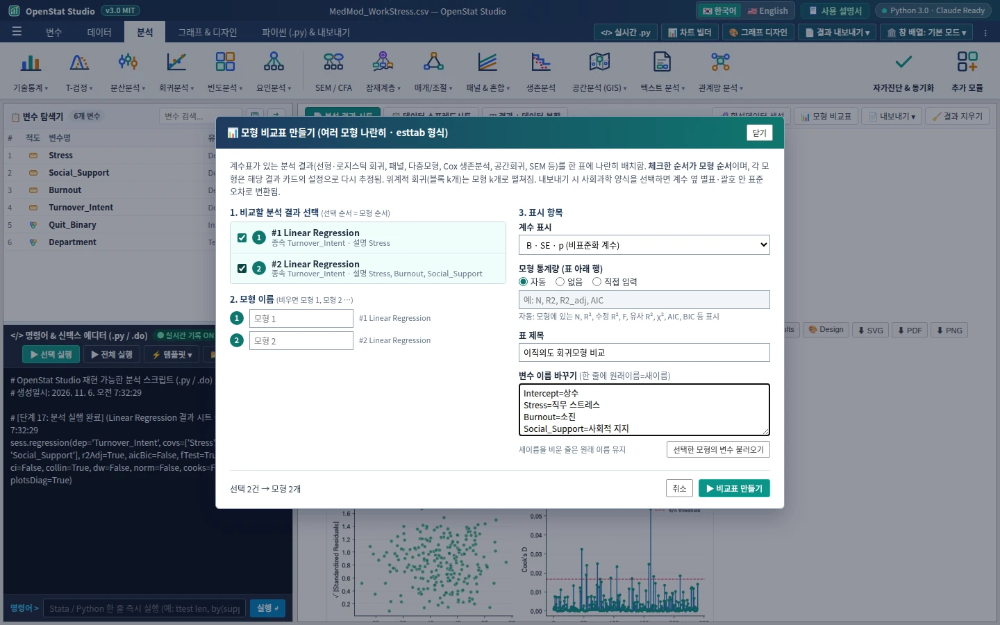</a> <b>모형 비교표 설정</b> — 비교할 회귀모형 선택, 모형 이름·변수 이름·표시 통계량 지정</td>
<td width="50%" valign="top"><a href="docs/images/09_compare_table.webp">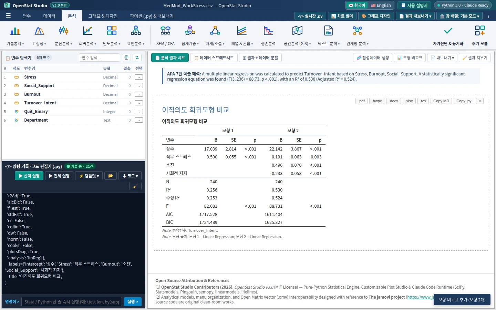</a> <b>모형 비교표 결과</b> — Stata esttab 형식의 모형 비교표(아래쪽 N·R²·수정 R²·F·AIC·BIC)</td>
</tr>
<tr>
<td width="50%" valign="top"><a href="docs/images/10_report_style.webp">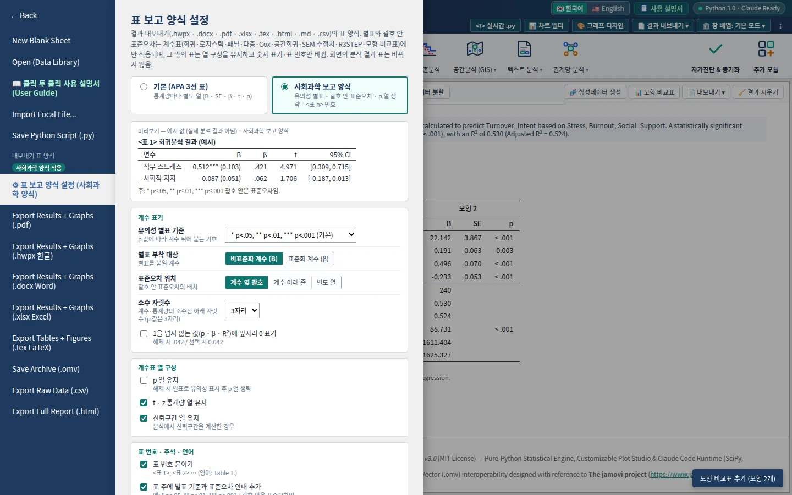</a> <b>표 보고 양식</b> — APA 기본 양식과 사회과학 보고 양식(유의수준 별표·괄호 표준오차·「<표 n>」 번호) 선택, 미리보기</td>
<td width="50%" valign="top"><a href="docs/images/11_sem_builder.webp">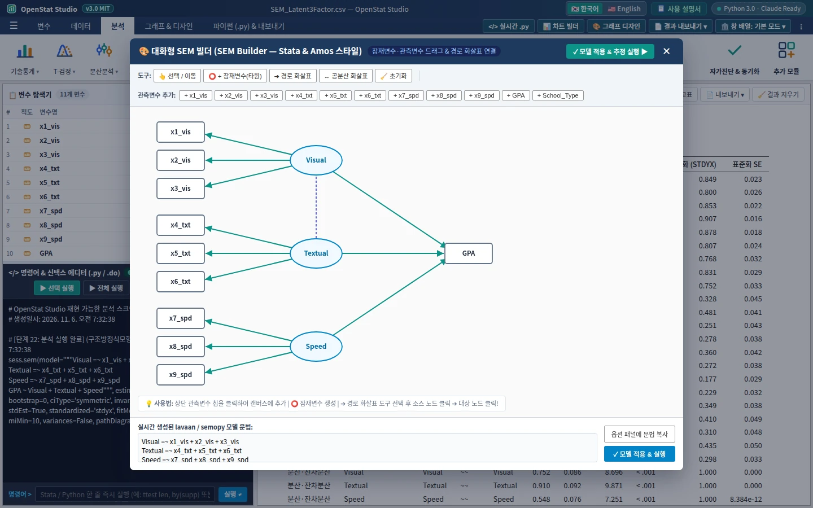</a> <b>SEM 빌더</b> — 잠재변수·관측변수·경로를 그려 구조방정식 모형 문법 생성</td>
</tr>
<tr>
<td width="50%" valign="top"><a href="docs/images/12_sem_results.webp">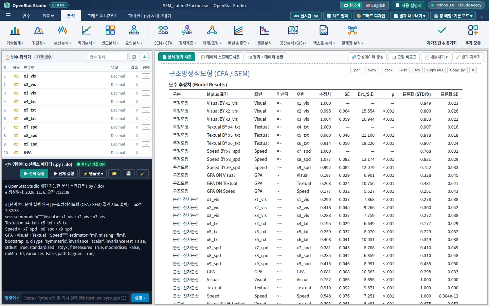</a> <b>구조방정식 결과</b> — Mplus 표기(BY·ON) 병기 모수 추정치와 표준화 추정치(STDYX)</td>
<td width="50%" valign="top"><a href="docs/images/13_lca_profile.webp">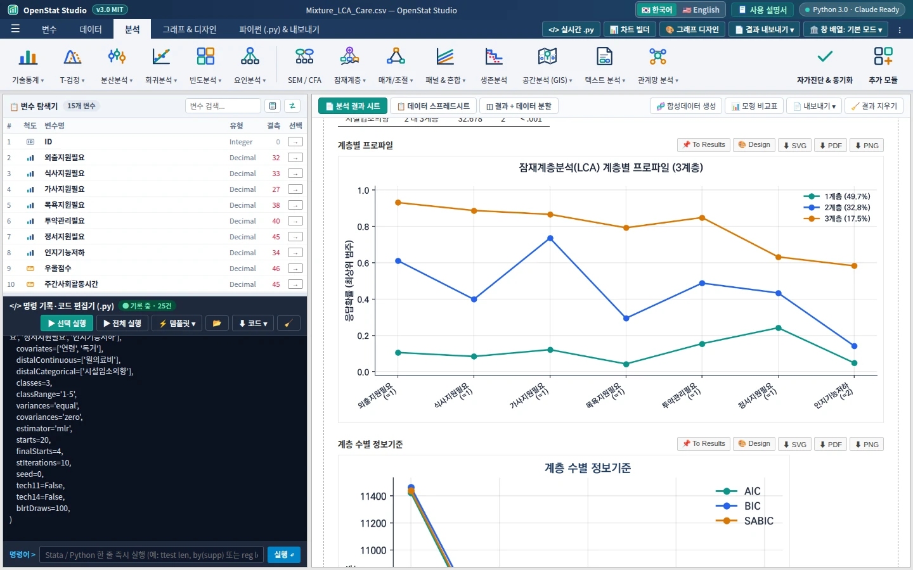</a> <b>잠재계층분석</b> — 계층별 응답확률 프로파일과 계층 수별 정보기준(AIC·BIC·SABIC)</td>
</tr>
<tr>
<td width="50%" valign="top"><a href="docs/images/14_gis_lisa.webp">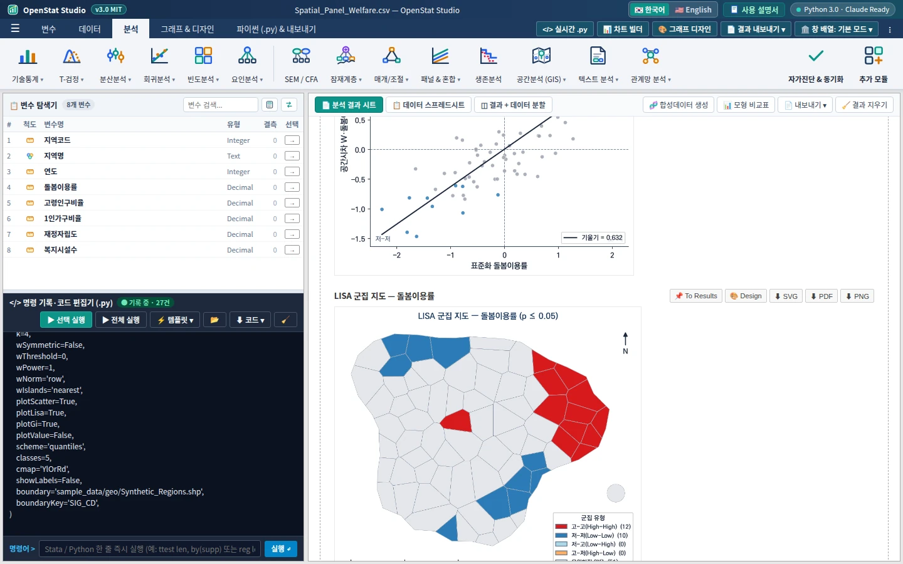</a> <b>GIS 공간분석</b> — Moran 산점도와 LISA 군집 지도(지도 경계 파일 자동 연결)</td>
<td width="50%" valign="top"><a href="docs/images/15_text_network.webp">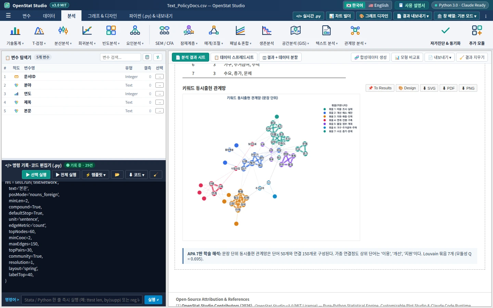</a> <b>텍스트 분석</b> — 정책문서 키워드 동시출현 관계망과 Louvain 묶음</td>
</tr>
<tr>
<td width="50%" valign="top"><a href="docs/images/16_synthetic_data.webp">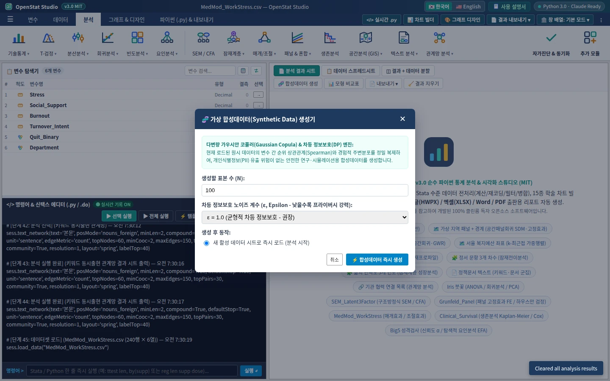</a> <b>합성데이터 생성기</b> — 현재 자료의 변수 간 순위상관·주변분포를 따르는 가상 자료 생성, 노이즈 수준(ε) 선택</td>
<td width="50%" valign="top"><a href="docs/images/17_data_merge.webp">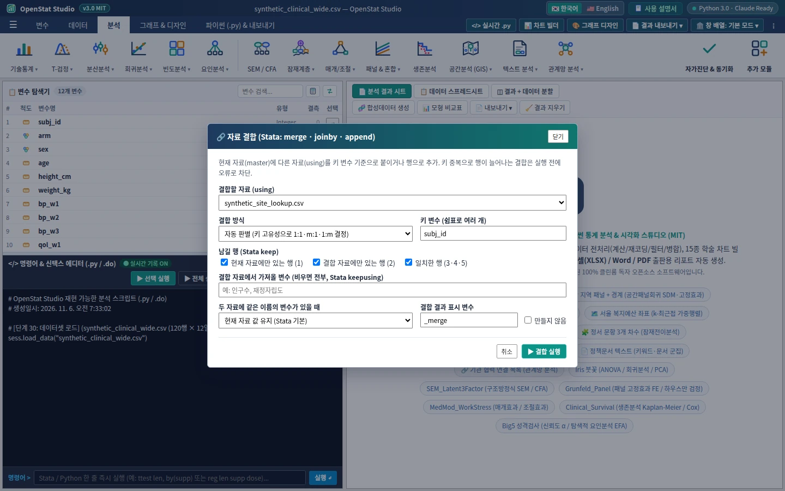</a> <b>자료 결합</b> — Stata merge 방식의 자료 결합(1:1·m:1·1:m 자동 판별, _merge 표시 변수)</td>
</tr>
<tr>
<td width="50%" valign="top"><a href="docs/images/18_doctor.webp">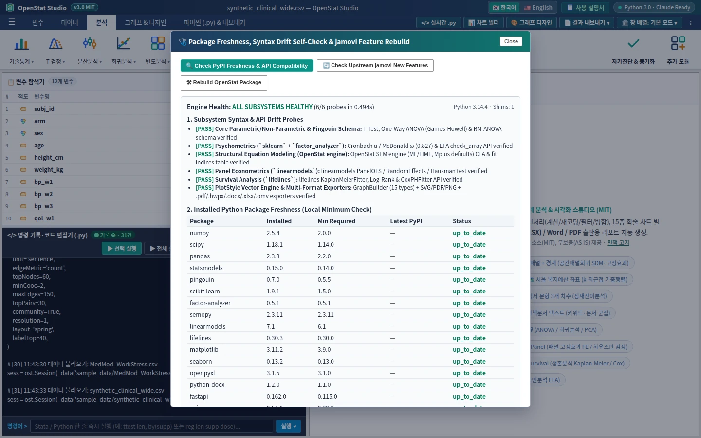</a> <b>자가진단</b> — 통계 엔진 하위 기능·API 호환성 점검과 설치 패키지 최신성 확인</td>
<td width="50%" valign="top"><a href="docs/images/19_hwpx_output.webp">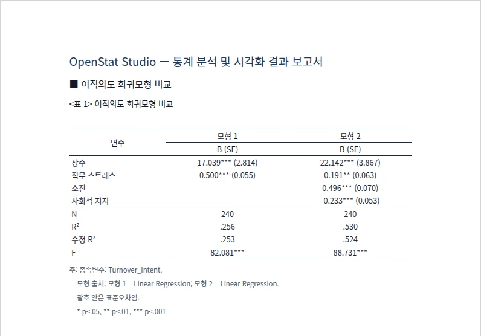</a> <b>한글(.hwpx) 출력</b> — 사회과학 보고 양식으로 저장한 모형 비교표(python-hwpx 미리보기로 렌더링, 한컴오피스 화면과 서체·간격 차이 가능)</td>
</tr>
</table>

---

## 🚀 1. 설치 및 실행 (3초 퀵스타트)

OpenStat Studio는 파이썬 초보자부터 데이터 사이언티스트까지 누구나 바로 쓸 수 있도록 설계되었습니다.

### 🌟 1단계: 다운로드
1. GitHub 페이지 오른쪽 위의 초록색 **[Code]** 버튼을 누르고 **[Download ZIP]** 을 클릭합니다.
2. 다운로드받은 압축 파일의 압축을 원하는 폴더에 풉니다.

### 🌟 2단계: 마우스 더블클릭 실행
- **Windows 사용자**: 폴더 안에 있는 **`OPENSTAT_실행.bat`** (또는 `START_OPENSTAT.bat`)을 마우스로 더블클릭합니다!
- **Mac / Linux 사용자**: 터미널을 열고 `./START_OPENSTAT.sh` 를 실행합니다.

> **최초 1회 실행 시 자동 환경 구성**:
> 컴퓨터에 Python 3.10 이상이 설치되어 있으면, 프로그램이 스스로 가상환경(`.venv`)을 만들고 필요한 통계 패키지들을 알아서 설치합니다 (약 1분 소요).  
> 설치가 끝나면 Microsoft Edge 또는 Chrome 브라우저를 독립 앱 창으로 띄워 오픈스탯 스튜디오가 실행됩니다.  
> 2회차 실행부터는 기다림 없이 1초 만에 바로 실행됩니다!
>
> **공유 폴더에서 실행하는 경우**: 다른 PC의 공유 폴더(네트워크 드라이브)에서 더블클릭하면 이 PC의 `%USERPROFILE%\OpenStatStudio`로 프로그램을 복사·갱신한 뒤 로컬 사본을 실행 (위치 변경: 환경변수 `OPENSTAT_LOCAL_DIR`).

### 🛑 프로그램 종료하기
- 검은색 콘솔 창을 닫거나, 콘솔 창에서 아무 키나 누르면 백그라운드 프로세스가 남지 않고 안전하게 종료됩니다.
- 필요할 경우 `STOP_OPENSTAT.bat` (Mac/Linux는 `./STOP_OPENSTAT.sh`)을 실행하여 강제 종료할 수도 있습니다.

---

## 🤖 2. Claude Code AI 에이전트로 분석하기

터미널에서 AI 에이전트(Claude Code, Antigravity, Cursor 등)에게 말로 지시하여 데이터를 분석할 수 있습니다.

### 🌟 Claude Code 데스크톱 앱에서 바로 실행·분석하기 (권장)

1. Claude 데스크톱 앱의 **Code** 탭에서 새 세션을 만들고, 작업 폴더로 **이 프로그램 폴더**(압축을 푼 폴더)를 선택
2. 입력창에 `프로그램 실행하여 분석 시작` 입력 → Claude가 폴더의 안내 파일(`CLAUDE.md` 0절) 절차대로 진행. 폴더 전체를 읽지 않고, 처음 한 번만 실행 환경을 설치(1~2분)한 뒤 **컴퓨터의 기본 브라우저**에서 프로그램을 엶
3. 분석할 파일과 목적을 말로 지시 (예: *"D:\\연구\\설문.xlsx 열어서 연령대별 만족도 차이를 분산분석으로, 사후검정은 Games-Howell로"*) → 결과가 브라우저 화면에 바로 나타나고, 모든 명령이 `workspace/command_log.py`에 누적 기록됨
4. *"결과를 한글(.hwpx)로 저장하고 명령 기록은 Stata do-file로도 줘"*처럼 내보내기·코드 변환 요청 가능
5. 마칠 때 `프로그램 종료` 입력 → Claude가 실행한 프로그램(서버)을 끔

### 🌟 터미널에서 사용하기

### 🌟 1회성 연동 설정
폴더 안에 있는 **`SETUP_CLAUDE_CODE.bat`** (Mac/Linux는 `./SETUP_CLAUDE_CODE.sh`)을 더블클릭합니다.  
프로그램이 현재 컴퓨터 경로를 스스로 인식하여 Claude Code에 OpenStat 도구를 자동 등록합니다.

### 🌟 실전 대화 예시
프로젝트 폴더에서 터미널을 열고 `claude`를 실행한 후 다음과 같이 입력해 보세요:

1. **데이터 탐색 및 요약**:
   > *"sample_data/ToothGrowth.csv 데이터 열어서 변수 요약해 주고, dose별 len 기술통계량 구해줘"*
2. **가설 검정 및 분산분석**:
   > *"dose를 독립변수로, len을 종속변수로 일원배치 분산분석(ANOVA) 돌려줘. 등분산성이 깨졌을 때 쓸 Games-Howell 사후검정도 같이 넣고, 박스플롯도 그려줘"*
3. **데이터 가공 (Stata do-file 동등 기능)**:
   > *"환자 데이터에서 체중(weight)과 신장(height)으로 BMI 변수를 새로 계산하고, 연령(age)을 20대/30대/40대/50대이상으로 범주화(recode)해줘"*
4. **고급 패널 계량경제학 분석**:
   > *"Grunfeld_Panel.csv 패널 데이터로 고정효과(Fixed Effects) 모형 돌리고 하우스만 검정(Hausman test) 결과 해석해 줘"*
5. **보고서 파일 내보내기**:
   > *"지금까지 분석한 모든 표와 그래프를 논문 작성용 한글(HWPX) 파일과 엑셀(XLSX) 파일로 저장해줘"*

---

## 📊 3. 지원하는 통계 분석 모형

| 분류 | 분석 모듈 명칭 | 상세 기능 및 특징 |
| :--- | :--- | :--- |
| **탐색 및 기술통계** | `descriptives` | 평균, 표준편차, 왜도/첨도, 사분위수, Shapiro-Wilk 정규성 검정 |
| | `scatr` | 산점도, 선형/LOESS 평활선, 주변 밀도곡선, 주변 박스플롯 |
| | `pareto`, `qqplot` | 품질관리 파레토 차트, Q-Q 정규확률도 |
| **T-검정 & 분산분석** | `ttestIS`, `ttestPS`, `ttestOneS` | 독립표본/대응표본/일표본 T-검정, Cohen's d 효과크기 |
| | `anovaOneW` | Fisher & Welch 일원분산분석, 등분산 검정(Levene) |
| | `anovaFactorial` | 다원 요인분산분석 (Type I/II/III SS, $\eta^2$, $\eta^2_p$, $\omega^2$) |
| | `anovaANCOVA` | 공분산분석, 공변량 통제 후 수정평균 산출 |
| | `anovaRM` | 반복측정 분산분석, Mauchly 구형성 검정, GG/HF 보정 |
| | `post_hoc` | **5종 사후검정** (Tukey HSD, Games-Howell, Scheffé, Bonferroni, Holm) |
| | `kruskal` | 비모수 분산분석 (Kruskal-Wallis H 검정) |
| **회귀 & 범주형** | `corrmatrix`, `partial_corr` | Pearson/Spearman 상관행렬, 편상관분석 |
| | `linReg` | OLS 다중회귀, VIF 다중공선성, Durbin-Watson 잔차독립성, 2×2 진단도 |
| | `logRegBin` | 이항 로지스틱 회귀, 오즈비(Odds Ratio), ROC/AUC 곡선 |
| | `crosstab` | 교차분할표, $\chi^2$ 독립성 검정, Fisher 직접확률, Cramér's V |
| **요인 & 신뢰도** | `reliability` | Cronbach's $\alpha$, McDonald's $\omega$, 항목 제거 시 신뢰도 |
| | `pca`, `efa` | 주성분분석, 탐색적 요인분석(Varimax/Promax/Oblimin, Scree Plot) |
| **구조방정식 (SEM)** | `sem` | Mplus 기본 설정(ML·FIML·평균구조), MLR, 다집단·측정동일성, 간접효과, 수정지수, STDYX, 적합도(χ²·RMSEA·CFI·TLI·SRMR) |
| **잠재계층·혼합모형** | `lca` | 잠재계층(LCA)·잠재프로파일(LPA), 계층 수 비교, TECH11·TECH14, R3STEP·BCH·DCAT (Mplus 기본 설정) |
| | `lta` | 잠재전이분석: 시점별 계층 비율, 전이확률, 측정동일성 |
| | `lcga` | 잠재계층 성장분석: 계층별 성장요인 평균(선형·2차·3차), FIML |
| **패널 & 다층모형** | `panel` | 개체 고정효과(Entity FE), 이원 고정효과, 확률효과(RE), 하우스만 검정 |
| | `mixedModel` | 선형 혼합모형(Multilevel Linear Mixed Model), REML, ICC 계산 |
| **베이지안 & 생존분석** | `bayesTTestIS`, `bayesANOVA` | JZS 코시 사전분포 기반 베이지안 가설검정 ($BF_{10}$) |
| | `mediation`, `moderation` | 부트스트랩 매개효과, 상호작용 조절효과 및 단순기울기(Simple Slopes) |
| | `survival` | Kaplan-Meier 생존곡선 분석, Cox 비례위험 회귀분석 |

| **텍스트 분석** | `textKeywords` | 형태소 분석(kiwipiepy), 빈도·TF-IDF, 집단별 특징 키워드(c-TF-IDF), 워드클라우드 |
| | `textNetwork` | 키워드 동시출현 관계망, 중심성, Louvain 묶음 |
| | `textCluster` | 문서 임베딩(TF-IDF+LSA 또는 bge-m3) → UMAP → HDBSCAN 군집, 군집 키워드, 주제 묶음, 관계망 |
| **관계망 분석** | `graphNetwork` | 연결 목록 기반 중심성 6종, 밀도·경로 길이, Louvain 묶음, 관계망 그림 |
| **GIS 공간분석** | `spatialWeights` | 공간가중행렬(퀸·룩 인접, k-최근접, 거리, 역거리, 외부 파일), 정규화·고립 지역 처리, .gal·.gwt·.csv 저장 |
| | `spatial_moran` | 전역 Moran's I(정규 근사·순열), LISA 군집(FDR·Bonferroni), Getis–Ord Gi* |
| | `spatial` | 횡단면 공간회귀 OLS·SLX·SAR·SEM·SDM·SDEM·SAC, LM 진단, 모형 비교·LR 검정, 직접·간접·총효과 |
| | `spatialPanel` | 공간패널회귀 고정효과(지역·시점·양방향, Lee–Yu 보정)·확률효과, Hausman, 패널 LM (Stata xsmle·spxtregress 대응) |
| | `gwr` | 지리가중회귀(커널·대역폭 선택, 국지 계수 지도, 공간 변이 검정) |
| | `spatialMap` | 주제도(분위수·자연 구분·등간격 단계구분도) |

> **텍스트 파일 불러오기**: [텍스트 분석 ▸ 텍스트 파일 불러오기]에서 `.txt` `.md` `.docx` `.pdf` `.hwpx` 파일이나 폴더를 선택하면 문서 1건 = 1행 데이터로 변환 (하위 폴더 이름은 '폴더' 변수에 기록).

> **지도 경계 연결**: [데이터 ▸ 지도 경계 연결]에서 `.shp`·`.shx`·`.dbf`(선택 `.prj`·`.cpg`) 또는 `.zip`·`.geojson`·`.gpkg`를 선택하고 데이터의 지역 코드 변수와 경계 속성을 연결 (연결 변수 자동 추천, 일치 지역 수 표시). 경계 없이 경도·위도 좌표 변수로도 분석 가능.

---

## 📈 4. 독립형 15종 학술 그래프 빌더

통계 분석을 돌리지 않고도 데이터만으로 즉시 출판 수준의 그래프를 작성할 수 있습니다:
- **차트 유형**: 막대그래프(`bar`), 누적막대(`stacked_bar`), 선그래프(`line`), 영역도(`area`), 원그래프(`pie`), 도넛차트(`donut`), 히스토그램(`histogram`), 커널밀도곡선(`density`), 상자수염도(`box`), 바이올린플롯(`violin`), 레인클라우드플롯(`raincloud`), 산점도(`scatter`), 다변량 산점도행렬(`pairplot`), 상관 히트맵(`heatmap`), 오차막대 포레스트플롯(`errorbar`).
- **학술 팔레트**: `openstat`, `apa_bw`(흑백 APA), `nature`, `lancet`, `kihasa`(한국보건사회연구원 스타일), `okabe_ito`(색각이상자 배려), `viridis` 등 10종 지원.
- **포맷 내보내기**: 무손실 벡터 SVG, 인쇄용 PDF, 고해상도(300~600 DPI) PNG.

---

## 📄 5. 11개 포맷 결과 내보내기

분석된 APA 통계 표와 렌더링된 모든 그래프를 다음 형식으로 한 번에 내보낼 수 있습니다:
1. **`.hwpx`**: 한글 표준 규격(OWPML)의 편집 가능한 네이티브 표(`<hp:tbl>`)와 본문에 자동 삽입된 그래프 이미지(`<hp:pic>`)
2. **`.pdf`**: 출판 논문 형식의 다면 리포트
3. **`.docx`**: 마이크로소프트 워드 문서 (APA 3선 테두리 표 + 차트)
4. **`.xlsx`**: 엑셀 워크북 (통계 표 시트 + 차트 전용 시트)
5. **`.tex`**: LaTeX `booktabs` 테이블 코드 + PDF 벡터 그림 파일 연동
6. **기타**: `.html`, `.md`, `.csv`, `.tsv`, `.json`, `.omv`

**사회과학 보고 양식**: ☰ 메뉴의 「표 보고 양식 설정」에서 사회과학 양식을 고르면 회귀 계열 계수표에 유의수준 별표, 괄호 표준오차(계수 옆·아래 줄·별도 열), p 열 생략, 「<표 n>」 번호가 적용됩니다. 기술통계·분산분석 등 다른 표는 열 구성을 유지합니다. Python에서는 `sess.export_results("결과.hwpx", report_style="social")`.

**모형 비교표**: 여러 회귀모형(또는 위계적 회귀의 블록)을 열로 나란히 놓고 아래에 N·R²·AIC를 두는 Stata `esttab` 형식 표를 만듭니다. Python에서는 `sess.compare_models(모형1, 모형2)`.

---

## ❓ 자주 묻는 질문 (FAQ) & 문제 해결

### Q1. "파이썬이 설치되어 있지 않다"는 메시지가 뜹니다.
- **해결책**: [https://www.python.org/downloads/](https://www.python.org/downloads/) 에 접속하여 파이썬 최신 버전을 다운로드하여 설치하세요.
- **★ 중요**: 파이썬 설치 화면 맨 첫 창 아래쪽에 있는 **`[Add python.exe to PATH]`** 체크박스에 꼭 체크를 하고 설치를 진행해야 합니다!

### Q2. 사내망이나 학교망에서 패키지 다운로드가 느리거나 방화벽에 막힙니다.
- `requirements.txt`에 명시된 패키지들을 다운로드받는 과정에서 보안 프로그램이 차단할 경우, 프록시 설정이나 네트워크 예외 처리를 확인해 주세요.

### Q3. 분석 결과가 Stata·SPSS 등 다른 프로그램과 일치하나요?
- 주요 분석은 표준 알고리즘으로 구현하였고, 공간회귀·구조방정식 등 일부 분석은 기준 패키지 결과와 대조하는 자동 테스트(`tests/`)를 갖추었음. 다만 추정 방법·기본 설정·결측 처리 방식에 따라 프로그램 간 결과가 달라질 수 있으며, 모든 분석·옵션 조합의 결과 일치를 보증하지 않음. 논문·보고서에 사용하기 전 다른 프로그램으로 교차 확인 권장([면책 고지](#disclaimer) 참조)

---

## ⚠️ 면책 고지 및 이용 조건

본 고지는 [MIT License](LICENSE)의 보증 부인·책임 제한 조항에 더하여 적용됨. 본 프로그램을 내려받거나 사용하는 경우 이 고지에 동의한 것으로 봄.

1. **개발 주체**: 본 프로그램은 개인 개발자가 개인 자격으로 개발·공개한 오픈소스 소프트웨어임. 개발자가 소속된 기관이나 제3자의 공식 제품·서비스·견해와 무관함
2. **무보증**: 본 프로그램과 설명자료는 "있는 그대로(AS IS)" 제공됨. 정확성·완전성·상품성·특정 목적 적합성·오류 없는 작동·지속 제공에 대해 명시적·묵시적 보증을 하지 않음
3. **분석 결과의 확인 책임**: 분석 결과(추정값·검정 통계량·그림·내보낸 문서)의 해석과 사용 책임은 이용자에게 있음. 학술 발표, 정책 결정, 임상·법률·재무 판단 등 중요한 용도에 사용하기 전 검증된 다른 소프트웨어나 전문가 검토로 결과를 교차 확인해야 함. 다른 소프트웨어의 명칭이나 기본 설정을 표기한 기능(예: 「Mplus 기본 설정」, 「Stata merge 방식」)도 해당 소프트웨어와 같은 결과를 보증하지 않음
4. **책임 제한**: 관련 법령이 허용하는 최대 범위에서, 개발자와 기여자는 본 프로그램의 사용 또는 사용 불능, 프로그램 오류, 결과 차이, 자료 손실·파일 손상, 제3자 서비스 연동으로 발생한 직접·간접·부수·특별·결과적 손해에 대해 책임을 지지 않음
5. **자료와 개인정보**: 이용자가 불러오고 처리하는 자료의 적법한 수집·이용·보관·파기(「개인정보 보호법」, 「통계법」, 연구윤리·기관생명윤리위원회 규정 등 포함)는 이용자의 책임임. 분석은 이용자 PC에서 실행되나, 패키지 설치·최신성 점검(PyPI), 참고 프로그램 신규 기능 점검(GitHub), 문장 임베딩 모델 내려받기(Hugging Face) 기능은 외부 서버와 통신함. Claude Code 등 외부 AI 도구와 함께 사용하는 경우 자료와 결과가 해당 서비스 제공자에게 전송될 수 있으며, 그 처리는 해당 서비스의 약관을 따름. 민감 자료는 AI 연동 전 소속 기관의 규정을 확인해야 함
6. **합성데이터**: 합성데이터 생성 기능은 비식별 조치의 적정성이나 재식별 불가능성을 보증하지 않음. 합성데이터를 공개·반출하기 전 관련 기준에 따른 별도 평가가 필요함
7. **상표와 제3자 권리**: SPSS, Stata, SAS, Mplus, jamovi, JASP, 한글·한컴오피스, Microsoft Word·Excel, Claude 등 이 문서와 프로그램에 나오는 제품명·상표는 각 권리자의 소유임. 본 프로그램은 이들 권리자와 제휴·후원·보증 관계가 없으며, 제품명은 호환성과 기능 설명 목적으로만 사용함
8. **제3자 소프트웨어**: 본 프로그램이 설치·사용하는 제3자 패키지, 서체, 모델은 각자의 라이선스를 따름. 일부 GPL 패키지(`pingouin`, `factor_analyzer`)를 함께 묶어 재배포하는 경우 해당 라이선스 조건의 준수 책임은 재배포자에게 있음([NOTICE.md](NOTICE.md) 참조)
9. **게시 중단과 변경**: 저작권·상표권 등 권리 침해 우려가 제기되거나 개발자가 필요하다고 판단하는 경우, 사전 통지 없이 저장소와 배포물의 전부 또는 일부를 수정·비공개·삭제할 수 있음. 개발자는 기술 지원, 업데이트, 오류 수정을 제공할 의무가 없음
10. **권리 침해 신고**: 본 저장소의 내용이 권리를 침해한다고 판단되는 경우 [GitHub Issues](https://github.com/beaver21c/pyopenstat/issues)로 알려 주면 확인 후 조치함
